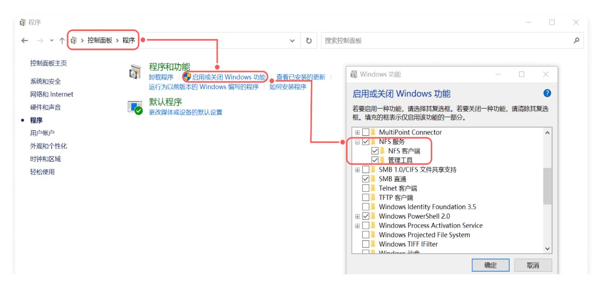

# 7.3 下载与同步：让 NAS 后台替你干活

> 📌 先读：[7.1 Docker 基础](7.1-Docker基础.md) · ⏱ 大约 15 分钟

## 下载工具

| 工具 | 协议 | 特点 |
| --- | --- | --- |
| qBittorrent | BT/磁力 | 功能全、Web UI 好用 ✅ |
| Transmission | BT/磁力 | 轻量简洁 |
| aria2 | HTTP/BT/磁力 | 命令行、多协议 |

> ⚠️ 请只下载合法内容，遵守当地法律法规。

部署示例在 [`examples/docker-compose/qbittorrent/`](../../examples/docker-compose/qbittorrent/docker-compose.yml)：

```yaml
services:
  qbittorrent:
    image: linuxserver/qbittorrent:latest
    container_name: qbittorrent
    environment:
      - PUID=1000
      - PGID=1000
      - TZ=Asia/Shanghai
      - WEBUI_PORT=8080
    volumes:
      - /volume1/docker/qbittorrent/config:/config
      - /volume1/downloads:/downloads
    ports:
      - "8080:8080"
      - "6881:6881"
      - "6881:6881/udp"
    restart: unless-stopped
```

要点：`/config` 持久化（种子和设置），下载目录指向 NAS 存储，跟影音库联动。首次登录用容器日志里的临时密码，**登录后立刻改掉**。

**NFS 常用于 Linux/影视设备访问 NAS**，飞牛里的开启界面如下：

<p align="center">
  
</p>

> 💡 截图来自 [飞牛官方帮助中心](https://help.fnnas.com/)（见 [致谢](../../CREDITS.md)）。

## 文件同步：Syncthing

Syncthing 是去中心化的点对点同步工具，适合多设备文件保持一致。

用途：手机照片回传、多台电脑文件夹同步、配置文件同步。部署示例在 [`examples/docker-compose/`](../../examples/README.md)。

> 💡 手机备份记得设"仅 WiFi"，并给 App 后台运行权限，不然它可能悄悄停止备份。

## 再说一遍：同步不是备份

这是全书强调过好几次的事，值得再写一遍。

> ⚠️ Syncthing、云盘同步、各种 Drive 都是**同步**：
>
> - 你在 A 删了，B 也跟着删
> - 文件被勒索加密，两端一起加密
>
> 同步解决"多设备一致"，备份解决"能回到过去"。**两样都要有。** 真备份见 [5.4](../../docs/05-存储与数据保护/5.4-备份3-2-1原则.md)。

## 手机照片怎么备份

- NAS 厂商 App（群晖 Moments、飞牛 App）：简单、本土化好
- Syncthing：跨平台、去中心化
- Nextcloud App：和私有云整合，见 [7.4](7.4-私有云与相册.md)

## 写在最后

下载工具让 NAS 后台干活，同步工具让多设备一致。但请牢记同步不是备份，重要数据仍需 3-2-1。

## 动手试试

1. 部署一个下载工具，测一个合法种子的下载，确认文件落在 NAS 存储。
2. 用自己的话说说"同步"和"备份"的一个关键区别。
