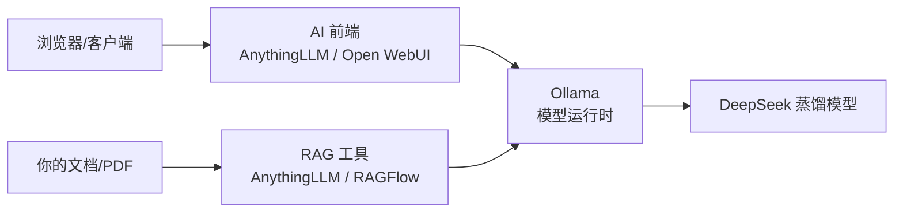

# 7.5 在 NAS 上跑 AI：自己的模型，自己的知识库

> 📌 先读：[7.1 Docker 基础](7.1-Docker基础.md) · ⏱ 大约 18 分钟

## 为什么想在家里跑 AI

三个理由：

- **隐私**：数据不出家门，处理敏感文档也放心
- **离线**：断网也能问答
- **成本**：用现有硬件，不用按 token 付费

代价也真实：硬件要求不低、速度不如云端大模型、要点运维能力。

## 典型组合



这套组合的意思：Ollama 负责跑模型，AnythingLLM 负责界面和知识库，你把文档喂进去，就能直接问"这份合同讲了什么"。这也是 [NEBULA](https://ooppll.icu/) 上那系列"把 DeepSeek 搬进 NAS"文章的核心玩法。

## 硬件够不够

| 部件 | 要求 | 说明 |
| --- | --- | --- |
| 内存 | 16GB 起，越大越好 | 模型加载进内存，最关键 |
| CPU | 多核 | 没显卡时靠 CPU，慢但能用 |
| GPU（可选） | NVIDIA，显存越大越好 | 大幅加速 |
| 存储 | SSD 优先 | 模型好几个 GB，加载速度重要 |

> 💡 7B/8B 的蒸馏模型（如 deepseek-r1:7b）在 16GB 内存的机器上能跑，速度看 CPU/GPU。新手从"小而快"的模型开始。

## 部署 Ollama

示例在 [`examples/docker-compose/ollama/`](../../examples/docker-compose/ollama/docker-compose.yml)。

```bash
# 拉模型
docker exec -it ollama ollama pull deepseek-r1:7b

# 测一下
docker exec -it ollama ollama run deepseek-r1:7b "你好"
```

## 搭配前端

- **Open WebUI**：功能全面的聊天界面
- **AnythingLLM**：内置知识库（RAG），能上传文档问答 ✅
- **Lobe Chat / NextChat**：体验好，支持多种模型
- **RAGFlow**：专注文档解析与检索

> 💡 新手组合：Ollama + AnythingLLM。这样你可以把合同、笔记喂给它，直接问要点，答案不出家门。

## 四条注意事项

> ⚠️ 1. **资源占用高**：模型跑起来内存/CPU 吃得多，可能影响其他服务。限制容器资源或错峰使用。
>
> ⚠️ 2. **安全**：AI 前端如果暴露公网，务必加认证 + HTTPS，否则会被人盗用算力。
>
> ⚠️ 3. **幻觉**：小模型会一本正经地胡说，重要内容请核实。
>
> ⚠️ 4. **合规**：遵守模型许可证和使用条款。

## 写在最后

NAS 跑 AI 已从不切实际变成可行方案。从 Ollama + 7B 模型起步，配 AnythingLLM 做知识库，注意内存和安全，慢慢升级。

## 动手试试

1. 评估你的硬件能跑多大的模型，写下选择。
2. 部署 Ollama + 一个 7B 模型，测一次问答，记下响应速度。
