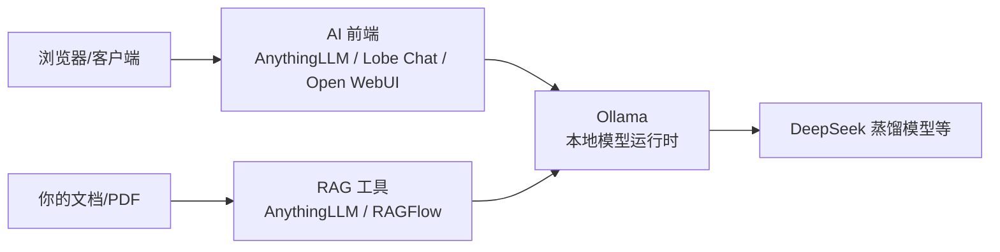

# 7.5 自托管 AI

<p align="center">
  
</p>


> 📌 先读：[7.1 Docker 基础](7.1-Docker基础.md) · ⏱ 约 18 分钟

## 这一节能帮你

- 理解在 NAS 上运行本地大模型的可行性
- 掌握 Ollama + 前端 + 知识库的基本组合
- 评估硬件要求与风险

## 为什么在 NAS 上跑 AI

- **隐私**：数据不出家门，适合处理敏感文档
- **离线可用**：断网也能问答
- **成本**：利用现有硬件，无需按 token 付费

代价是：硬件要求不低、速度不如云端大模型、需要一定运维能力。

## 典型架构



## 硬件要求

| 组件 | 要求 | 说明 |
| --- | --- | --- |
| 内存 | 16GB 起，越大越好 | 模型加载进内存，最关键的指标 |
| CPU | 多核 | 无 GPU 时靠 CPU 推理，较慢但可用 |
| GPU（可选） | NVIDIA，显存越大越好 | 显著加速，部分平台支持直通 |
| 存储 | SSD 优先 | 模型文件数 GB～数十 GB，加载速度重要 |

> 💡 7B/8B 的蒸馏模型（如 Deepseek-R1 蒸馏版）在 16GB 内存的机器上可以跑，但速度取决于 CPU/GPU。入门建议从"小而快"的模型开始。

## 部署 Ollama

Compose 示例见 [`examples/docker-compose/ollama/docker-compose.yml`](../../examples/docker-compose/ollama/docker-compose.yml)。

```yaml
services:
  ollama:
    image: ollama/ollama:latest
    container_name: ollama
    volumes:
      - /volume1/docker/ollama:/root/.ollama
    ports:
      - "11434:11434"
    restart: unless-stopped
```

部署后拉取模型：

```bash
# 进入容器或通过 API 拉取
docker exec -it ollama ollama pull deepseek-r1:7b

# 测试
docker exec -it ollama ollama run deepseek-r1:7b "你好"
```

## 搭配前端

- **Open WebUI**：功能全面的聊天界面
- **Lobe Chat / NextChat**：体验好，支持多种模型
- **AnythingLLM**：内置知识库（RAG），可上传文档问答
- **RAGFlow**：专注文档解析与检索

> 💡 组合建议：Ollama（模型运行时）+ AnythingLLM（知识库 + 界面）。这样你可以把合同、笔记喂给它，直接问"这份合同的要点是什么"。呼应社区里流行的"接 DeepSeek 自建知识库"玩法。

## 模型选择建议

- 从 **7B/8B 蒸馏模型**起步（如 deepseek-r1:7b），速度快、内存友好
- 中文场景优先选对中文支持好的模型
- 根据内存逐步尝试更大模型

## 风险与注意事项

> ⚠️ 1. **资源占用**：模型运行时内存/CPU 占用高，可能影响 NAS 其他服务。建议限制容器资源，或错峰使用。
>
> ⚠️ 2. **安全**：AI 前端若暴露公网，务必加认证 + HTTPS，否则会被他人盗用算力。
>
> ⚠️ 3. **幻觉**：本地小模型能力有限，输出仅供参考，重要内容请核实。
>
> ⚠️ 4. **合规**：遵守模型许可证与使用条款。

## 写在最后

NAS 跑 AI 已从"极客玩具"变成可行方案。从 Ollama + 小模型起步，配 AnythingLLM 做知识库，注意内存与安全防护。

## 动手试试

1. 评估你的 NAS 内存与 CPU，判断能跑多大的模型。
2. 部署 Ollama 并拉取一个 7B 模型，测试一次问答，记录响应速度。
