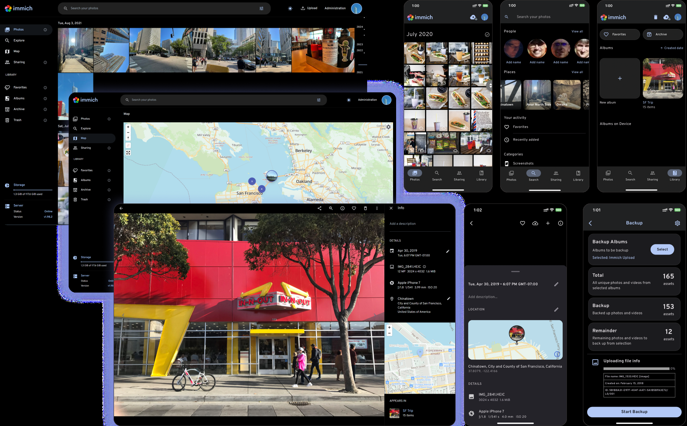
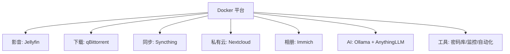

  

# 07 玩起来：让小盒子真正干活

> ⏱ 大约 70 分钟 · 难度 ⭐⭐⭐ · 这一章开始装应用

  

> 💡 真实界面截图来自 [github.com](https://github.com/immich-app/immich)，见 [致谢](../../CREDITS.md)。

## 前面都在搭台，这一章开始唱戏

想象一下你现在的状态：NAS 有了、数据安全守住了、网络也通了。

它是台好机器，但……它能干嘛？

这一章就是把"能存东西的小盒子"变成"家庭服务中心"。看点电影、自动下剧、手机照片自动备份，甚至——在自己家里跑个 AI。

## 先看一眼全景

这些应用绝大多数都通过 Docker 安装。所以 7.1 是这一章的地基，值得先啃。

## 三条铁律，刻在心里

> ⚠️ **第一，数据要持久化。** 容器可以随时删，但数据必须存在 NAS 的目录里。否则删容器时，数据跟着一起没。
>
> ⚠️ **第二，凭据别写死。** 密码放 `.env` 文件，别直接写进配置文件。
>
> 💡 **第三，只装你真会用的。** 见过太多人一口气装了二十个服务，最后还在用的就三个。**收集式部署**是吃灰的开始。

## 路线一览

| 小节 | 装什么 | 大概难度 |
| --- | --- | --- |
| [7.1 Docker 基础](7.1-Docker基础.md) | 容器心智模型 | 地基，先读 |
| [7.2 影音中心](7.2-影音中心.md) | Jellyfin | ⭐⭐ |
| [7.3 下载与同步](7.3-下载与同步.md) | qBittorrent / Syncthing | ⭐⭐ |
| [7.4 私有云与相册](7.4-私有云与相册.md) | Nextcloud / Immich | ⭐⭐⭐ |
| [7.5 自托管 AI](7.5-自托管AI.md) | Ollama / DeepSeek | ⭐⭐⭐ |

## 配图里的那个画面

本章开头那张手绘图，画的是一家人在沙发上看电影——这正是很多人的终极目标：**技术藏在背后，生活走到前面。**

一台安静的 NAS，让家人不用懂技术也能享受便利。这就是我们折腾的意义。

## 来自社区的新玩法

在 [NEBULA](https://ooppll.icu/) 上，有人写了一系列"把 DeepSeek 搬进 NAS"的文章——Ollama 跑蒸馏模型、AnythingLLM 接知识库、RAGFlow 解析 PDF。这些玩法我们在 [7.5](7.5-自托管AI.md) 会梳理清楚，让你也能在家里问一句"这份合同的要点是什么"，而且答案不出家门。

## 小练习

翻到 [exercises/07-应用服务.md](../../exercises/07-应用服务.md)。先部署 **一个** 应用，确认数据持久化没问题，再考虑第二个。
