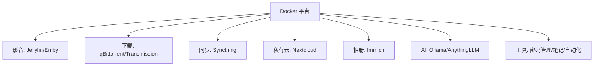

# 07 应用服务 · 本章概览

> 难度：⭐⭐⭐ · 预计阅读：70 分钟 · 是否需要设备：是

## 本章目标

读完本章，你将能够：

1. 理解 Docker 的核心概念并部署容器化应用
2. 搭建影音中心、下载同步、私有云相册等常见服务
3. 了解在 NAS 上运行本地 AI（如 DeepSeek）的方法与硬件要求
4. 理解数据持久化与权限配置的重要性

## 核心主题

- **Docker 是基础**：现代 NAS 应用的通用运行方式
- **数据要持久化**：容器可随时删，数据必须留在外面
- **安全第一**：不滥用 root、不暴露端口、妥善管理凭据
- **按需部署**：装你真正会用的服务，避免"收集式部署"

## 小节列表

| 小节 | 核心问题 | 关键产出 |
| --- | --- | --- |
| [7.1 Docker 基础](7.1-Docker基础.md) | 容器怎么玩？ | Docker 基础能力 |
| [7.2 影音中心](7.2-影音中心.md) | 怎么建影片库？ | Jellyfin 服务 |
| [7.3 下载与同步](7.3-下载与同步.md) | 下载/同步怎么做？ | 下载器与同步工具 |
| [7.4 私有云与相册](7.4-私有云与相册.md) | 怎么替代网盘？ | Nextcloud/相册 |
| [7.5 自托管 AI](7.5-自托管AI.md) | NAS 能跑 AI 吗？ | Ollama + 知识库 |

## 应用生态全景

## 通用原则

> ⚠️ **三条铁律**：
> 1. **数据卷映射到 NAS 存储**：容器删了数据还在。
> 2. **凭据用环境变量或 secrets**：不要写死在镜像里。
> 3. **只暴露必要端口**：配合反代和 HTTPS，见第 6 章。

## 小结

应用服务让 NAS 从"硬盘柜"变成"家庭服务器"。先掌握 Docker，再按需逐个部署，每个都验证数据持久化。

## 练习

见 [`exercises/07-应用服务.md`](../../exercises/07-应用服务.md)。
