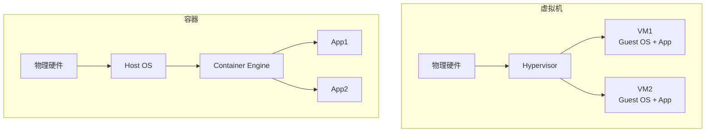

# 8.1 虚拟机与容器

> 📌 前置：[7.1 Docker 基础](../07-应用服务/7.1-Docker基础.md) · ⏱ 约 12 分钟

## 本章目标

- 理解虚拟机与容器的本质差异
- 知道什么场景用哪种

## 核心差异

| 维度 | 虚拟机 VM | 容器 Container |
| --- | --- | --- |
| 隔离级别 | 硬件级（完整系统） | 进程级（共享内核） |
| 启动速度 | 分钟级 | 秒级 |
| 资源开销 | 大（每个 VM 一套系统） | 小 |
| 系统支持 | 可跑不同系统（Windows/Linux） | 只能跑同内核系统 |
| 性能 | 有虚拟化损耗 | 接近原生 |
| 适合 | 完整系统、异构系统 | 应用服务、微服务 |

## 什么时候用虚拟机

- 需要跑**不同操作系统**（如在 Linux NAS 上跑 Windows）
- 需要完整系统环境的应用
- 强隔离需求（测试、实验）
- 某些必须 VM 的软路由/监控方案

## 什么时候用容器

- 部署单个应用服务（影音、下载、AI）
- 追求轻量与快速部署
- 微服务架构

> 💡 一般原则：**能用容器就用容器，需要完整系统或异构系统才用虚拟机。**

## 各平台支持

| 平台 | 虚拟机方案 |
| --- | --- |
| 群晖 | Virtual Machine Manager |
| 威联通 | Virtualization Station |
| TrueNAS SCALE | KVM 虚拟机 |
| 飞牛 fnOS | 虚拟机支持 |
| 通用 Linux | KVM / Proxmox VE |

> 💡 进阶玩家常在底层装 **Proxmox VE（PVE）**，把 NAS 作为其中一台虚拟机运行，实现"All in One"。这属于深度玩法，复杂度高，需谨慎规划。

## 资源分配建议

- **CPU**：不要过度分配 vCPU，按需给
- **内存**：为宿主机留足余量（ZFS/Docker 都需要内存）
- **存储**：VM 磁盘文件放在高速池（SSD），见 [5.1 文件系统](5.1-文件系统.md) 关于 CoW 与虚拟机的注意点

## 小结

VM 提供完整隔离、容器轻量高效。日常服务用容器，需要完整/异构系统时用 VM。别为了"能跑 VM"而盲目上虚拟化。

## 练习

1. 列出你当前跑的服务，判断哪些适合容器、哪些需要 VM。
2. 如果你打算 All in One，画出你的虚拟化层级图并标注风险点。
