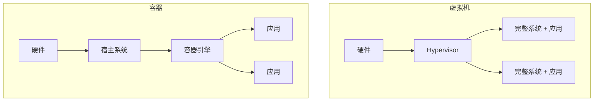

# 8.1 虚拟机和容器，该用哪个

> 📌 先读：[7.1 Docker 基础](../../docs/07-应用服务/7.1-Docker基础.md) · ⏱ 大约 12 分钟

## 一个比喻分清它们

- **虚拟机（VM）**：像在你家院子里盖了一栋完整的房子，有墙、有水电、有自己的一套系统
- **容器（Container）**：像在现有房子里隔出几个小房间，共用厨房和水电，但各自住各自的

## 对照表

| 维度 | 虚拟机 | 容器 |
| --- | --- | --- |
| 隔离程度 | 硬件级，完整系统 | 进程级，共享内核 |
| 启动 | 分钟级 | 秒级 |
| 开销 | 大（每个一套系统） | 小 |
| 能跑别的系统吗 | 能（Linux 上跑 Windows） | 不能，只能同内核 |
| 适合 | 异构系统、强隔离、测试 | 应用服务、微服务 |

## 什么时候用谁

**用容器**：部署影音、下载、相册、AI 这些单个应用——追求轻快、好装好删。这是 [第 7 章](../../docs/07-应用服务/README.md) 的主力。

**用虚拟机**：需要跑一个完整操作系统，或者跟宿主机不同的系统（比如在 Linux NAS 上跑 Windows），或者要强隔离的实验环境。

> 💡 一般原则：**能用容器就用容器，需要完整/异构系统才上虚拟机。**

## 各平台的支持

| 平台 | 虚拟机方案 |
| --- | --- |
| 群晖 | Virtual Machine Manager |
| 威联通 | Virtualization Station |
| TrueNAS SCALE | KVM 虚拟机 |
| 飞牛 fnOS | 虚拟机支持 |
| 通用 Linux | KVM / Proxmox VE |

有些进阶玩家会在最底层装 **Proxmox VE（PVE）**，把 NAS 本身也跑成一台虚拟机，做成"All in One"。这玩法复杂度高、故障影响面大，家庭用户量力而行。

## 资源分配的小提醒

- CPU 别过度分配 vCPU，按需给
- 内存要给宿主机留余量（ZFS、Docker 都吃内存）
- 虚拟机的磁盘文件放高速池（SSD），见 [5.1](../../docs/05-存储与数据保护/5.1-文件系统.md) 关于 CoW 的注意点

## 写在最后

VM 提供完整隔离，容器轻量高效。日常服务用容器，需要完整或异构系统时用 VM。别为了"能跑 VM"而盲目上虚拟化。

## 动手试试

1. 列出你现在跑的服务，判断哪些适合容器、哪些需要 VM。
2. 想想如果你要 All in One，画一张层级图，标出风险点。
