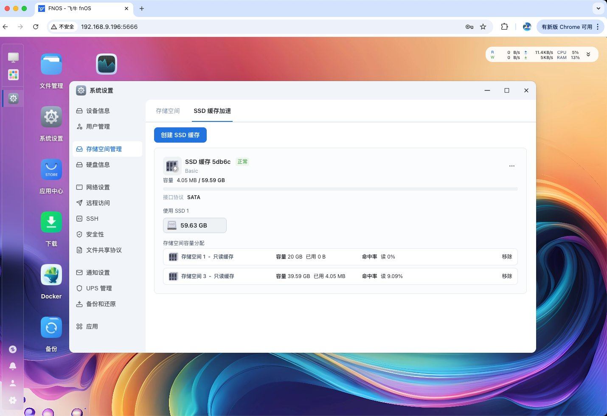
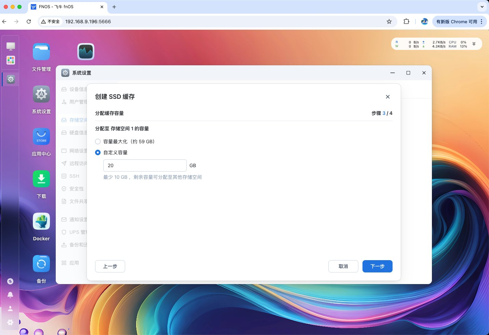

# 8.3 性能调优：先量，再调

> 📌 先读：[5.1 文件系统](../../docs/05-存储与数据保护/5.1-文件系统.md)、[6.1 局域网基础](../../docs/06-网络与远程访问/6.1-局域网基础.md) · ⏱ 大约 15 分钟

## 最重要的一句话

> ⚠️ **别凭感觉调优。先测出瓶颈在哪，再动手。**

盲目优化常常适得其反——比如你以为硬盘慢，结果瓶颈其实是百兆网口。折腾半天硬盘，速度纹丝不动。

正确的循环是：


## 拿什么测

| 层面 | 工具 |
| --- | --- |
| 磁盘 | `dd`、`fio`、`hdparm -tT` |
| 网络 | `iperf3`、实际复制文件 |
| 系统 | `top`/`htop`、`iostat`、`iotop` |
| ZFS | `zpool iostat`、`arc_summary` |

```bash
# fio 随机读写测试
fio --name=test --directory=/mnt/nas --rw=randrw --bs=4k \
    --size=1G --numjobs=4 --runtime=60 --time_based --group_reporting
```

**SSD 缓存是常见的加速手段**，飞牛里配置起来是图形化的：

<p align="center">
  
</p>

<p align="center">
  
</p>

> 💡 截图来自 [飞牛官方帮助中心](https://help.fnnas.com/)（见 [致谢](../../CREDITS.md)）。注意 SSD 缓存不是备份，见 [5.4](../05-存储与数据保护/5.4-备份3-2-1原则.md)。

## 常见的优化方向

**存储层**
- SSD 做高速池或缓存，放虚拟机、数据库、AI 数据
- ZFS 的 `recordsize` 按用途调（数据库小块，大文件大块）
- SSD 定期 TRIM

**网络层**
- 升级到 2.5G（见 [6.1](../../docs/06-网络与远程访问/6.1-局域网基础.md)）
- 链路聚合提升多客户端并发（注意：不会让单个连接变快）

**应用层**
- Jellyfin 开硬件转码、优先直播（见 [7.2](../../docs/07-应用服务/7.2-影音中心.md)）
- 数据库类应用放 SSD
- 限制容器资源，别互相抢

## ZFS 专项

```bash
# 看 ARC 缓存命中率
arc_summary | grep -i hit

# 调整数据集记录大小
sudo zfs set recordsize=16K tank/vmdata
```

命中率高说明缓存有效；低的话可能要加内存或调整使用方式。

## 什么时候该停手

> 💡 当性能已经够用，继续优化的边际收益就很低了。这时候把时间花在数据安全和备份上，回报通常大得多。

调优是为了解决问题，不是为了跑分好看。够用就好。

## 写在最后

测量 → 定位 → 优化 → 验证，循环往复。优先解决真正的瓶颈，别为了折腾而折腾。

## 动手试试

1. 用 fio/dd 测一次磁盘，iperf3 测一次网络。
2. 根据结果判断：你的瓶颈在存储、网络，还是应用层？
