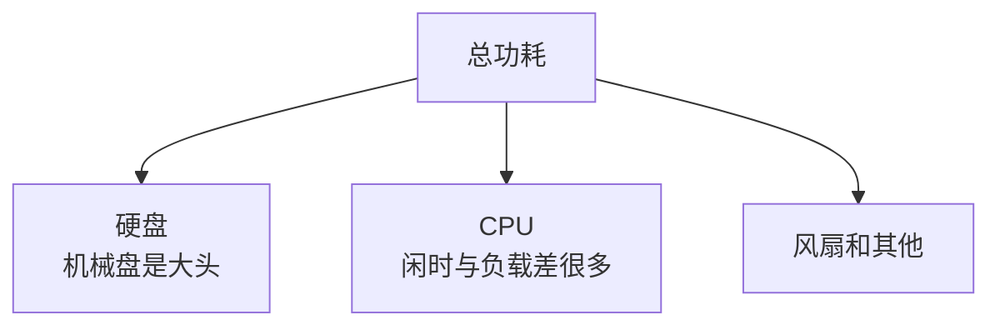

# 8.4 能耗优化：省电，但别省过头

> 📌 先读：[2.5 功耗噪音与散热](../../docs/02-硬件选型/2.5-功耗噪音与散热.md) · ⏱ 大约 10 分钟

## 先算笔账

NAS 常年开机，功耗 sitting 在那儿，一年下来也是钱。

```
年电费 ≈ 功耗(W) × 24 × 365 ÷ 1000 × 电价
```

比如 25W 常年跑，电价 0.6 元/度，一年大约 130 块。不算吓人，但也不是零。

## 电都花在哪儿了



多块机械硬盘往往是功耗和噪音的主要来源。

## 常见的省电办法

**硬盘休眠**：让长期闲置的盘停转。省电、静音，代价是唤醒延迟和频繁启停的损耗。

> ⚠️ 如果你有 7×24 跑的服务（下载、影音、监控），硬盘根本不会休眠，强求休眠意义不大。

**CPU 节能**：选低功耗 CPU、开频率调节、别让后台空转。

**其他**：用 SSD 替代机械盘、减少硬盘数量、关掉不用的 USB/PCIe 设备、用高效电源。

## 用插座测一下

最直观的办法是插座式功率计（或智能插座），直接读数字。UPS 通常也能显示负载功率。记下闲时和高负载两个值，心里就有数了。

## 省电和好用之间


过度省电会牺牲体验：硬盘唤醒要等、服务响应变慢。家庭 NAS 一般选"平衡"最实际。

## 进阶：让耗电任务错峰

用定时任务把备份、scrub、索引这些耗电活儿放到半夜，白天让机器轻松点。可以结合 cron 或 [8.2 Ansible](8.2-Ansible自动化运维.md)。

另外 UPS 不只是防断电，还能在断电时触发安全关机，护住数据一致性。见 [2.1](../../docs/02-硬件选型/2.1-核心部件选型.md)。

## 写在最后

先测量再优化。硬盘休眠有代价，7×24 服务场景不必强求。家庭 NAS 追求"平衡"最实在。

## 动手试试

1. 用功率计测一次闲时功耗，估算年电费。
2. 判断你的场景适不适合开硬盘休眠，写下理由。
