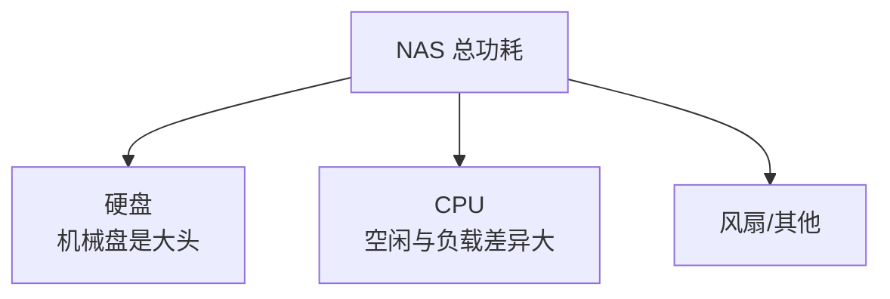

# 8.4 能耗优化

  

> 📌 先读：[2.5 功耗噪音与散热](../02-硬件选型/2.5-功耗噪音与散热.md) · ⏱ 约 10 分钟

## 这一节能帮你

- 理解 NAS 功耗的主要来源
- 掌握常见的节能手段与代价

## 功耗来源

机械硬盘（尤其多块）通常是功耗与噪音的主要来源。

## 节能手段

### 硬盘休眠

- 让长时间闲置的硬盘停转
- ✅ 省电、静音、延长寿命（某种程度上）
- ⚠️ 代价：唤醒延迟、频繁启停反而伤盘、某些服务（下载、监控）会不断唤醒硬盘

> 💡 **建议**：如果 NAS 上有 7×24 运行的服务（下载、影音、监控），硬盘几乎不会休眠，不必强求。

### CPU 节能

- 选择低功耗 CPU（见 [2.1](../02-硬件选型/2.1-核心部件选型.md)）
- 开启 CPU 频率调节（governor）
- 避免后台高负载任务

### 其他

- 用 SSD 替代机械盘（静音、低功耗，但成本高）
- 减少不必要的硬盘数量
- 关闭不用的 PCIe 设备/USB 设备
- 使用高效的电源（80 Plus 认证）

## 测量功耗

- 用插座式功率计（如各类智能插座）直接测量
- UPS 通常也能显示负载功率
- 记录空闲与高负载两种状态的数值

## 节能与可用性的平衡

> ⚠️ 过度追求省电会牺牲体验：硬盘唤醒等待、服务响应变慢。家庭 NAS 通常选"平衡"档即可。

## 自动化作息（进阶）

用定时任务在非高峰时段执行耗电任务（备份、scrub、索引），白天保持低功耗。可结合 Ansible（[8.2](8.2-Ansible自动化运维.md)）或系统 cron。

## UPS 的意义

UPS 不仅防断电，还能在断电时触发安全关机，保护数据一致性。见 [2.1](../02-硬件选型/2.1-核心部件选型.md)。

## 写在最后

先测量再优化。硬盘休眠省电但有代价，7×24 服务场景下不必强求。家庭 NAS 追求"平衡"最实际。

## 动手试试

1. 用功率计测一次 NAS 空闲功耗，估算年电费。
2. 判断你的使用场景是否适合开启硬盘休眠，说明理由。
