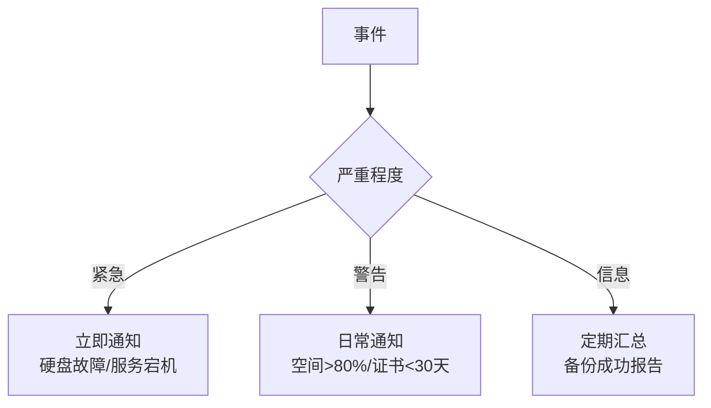

# 8.5 监控与告警

  

> 📌 前置：[5.5 硬盘健康监控](../05-存储与数据保护/5.5-硬盘健康监控.md) · ⏱ 约 15 分钟

## 本章目标

- 理解监控体系的组成
- 搭建基础的监控与告警

## 为什么需要监控

NAS 长期无人值守运行，问题往往在你没注意时发生：硬盘降级、服务挂掉、空间将满、证书过期。监控系统帮你"提前知道"，而不是"事后发现"。

## 监控什么

| 类别 | 指标 |
| --- | --- |
| 硬件 | CPU、内存、温度、硬盘 SMART、风扇 |
| 存储 | 池状态、空间使用率、RAID 状态 |
| 网络 | 连通性、带宽、端口状态 |
| 服务 | 容器健康、HTTP 可用性 |
| 备份 | 任务成功/失败、上次备份时间 |
| 证书 | 到期时间 |

## 常见方案

| 方案 | 特点 | 适合 |
| --- | --- | --- |
| 系统自带通知 | 简单、零成本 | 入门 ✅ |
| Uptime Kuma | 服务可用性监控，界面友好 | 服务监控 ✅ |
| Prometheus + Grafana | 强大、可定制 | 进阶 |
| Netdata | 实时、部署简单 | 实时观测 |

> 💡 入门建议：先用系统自带通知 + Uptime Kuma，覆盖大部分关键场景。

## Uptime Kuma 示例

Compose 示例见 [`examples/docker-compose/uptime-kuma/docker-compose.yml`](../../examples/docker-compose/uptime-kuma/docker-compose.yml)。

可监控：

- HTTP(s)：服务是否返回 200
- TCP 端口：服务端口是否可达
- Ping：设备是否在线
- 证书到期：SSL 证书剩余天数

## 告警渠道

- 邮件（SMTP）
- 即时通讯（Telegram / 企业微信 / 钉钉 Bot）
- Webhook（对接其他系统）

> 💡 配置后务必**发送测试告警**，确认能收到。很多"没收到告警"是因为配置错误或进了垃圾邮件箱。

## 告警分级

> ⚠️ 告警不宜过多，否则会"狼来了"被忽略。只对真正需要行动的事件告警。

## 自动化自愈（进阶）

结合脚本/Ansible，在告警时自动执行简单修复（如重启挂掉的容器）。但要谨慎：自动操作可能掩盖真实问题。

## 小结

监控让你"提前知道"，告警让你"及时行动"。从系统通知 + Uptime Kuma 起步，覆盖硬盘、服务、备份、证书等关键项。

## 练习

1. 配置一个 Uptime Kuma 监控项，监控你的 NAS Web 界面。
2. 设置告警渠道并发送测试消息，确认能收到。
