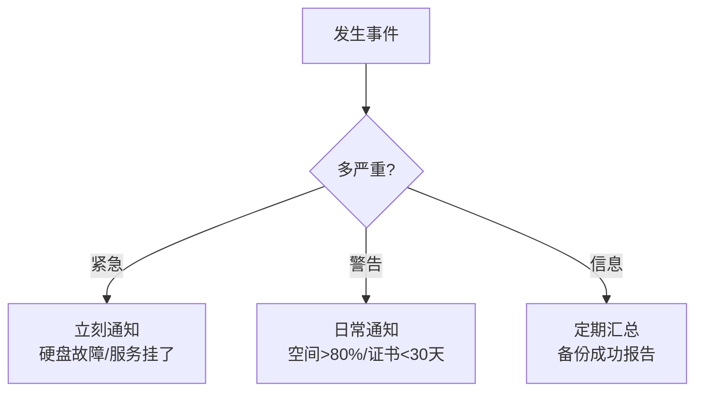

  

# 8.5 监控告警：让机器自己告诉你它不舒服

> 📌 先读：[5.5 硬盘健康监控](../../docs/05-存储与数据保护/5.5-硬盘健康监控.md) · ⏱ 大约 15 分钟

## 为什么要监控

NAS 常年无人值守地跑着。问题往往在你没注意的时候冒出来：硬盘降级了、服务挂了、空间快满了、证书快过期了。

等你发现时，可能已经晚了。

监控的作用就一句话：**让你提前知道，而不是事后追悔。**

## 盯什么

| 类别 | 具体指标 |
| --- | --- |
| 硬件 | CPU、内存、温度、硬盘 SMART、风扇 |
| 存储 | 池状态、空间占用、RAID 是否降级 |
| 网络 | 连通性、带宽、端口 |
| 服务 | 容器健康、网页能不能打开 |
| 备份 | 任务成功没、上次备份什么时候 |
| 证书 | 还剩多少天到期 |

## 从简单开始

不用一上来就 Prometheus + Grafana 那套。对家庭用户，两样就够：

1. **系统自带通知**——群晖/威联通/飞牛都有，先把邮件或 App 推送打通
2. **Uptime Kuma**——一个轻量的服务可用性监控，界面友好，还能盯证书到期

Uptime Kuma 的部署示例在 [`examples/docker-compose/uptime-kuma/`](../../examples/docker-compose/uptime-kuma/docker-compose.yml)。

它能盯：网页返回是否正常、端口通不通、设备在不在线、SSL 证书剩几天。

## 告警别太多

配好告警后，一定要**发一条测试消息**，确认你真的收得到。很多人以为配好了，结果进了垃圾邮件箱。

> ⚠️ 告警不是越多越好。什么都报，结果就是"狼来了"，最后真出事反而被忽略。只对**需要你行动**的事告警。

可以分个级：

## 告警发到哪儿

邮件、Telegram、企业微信、钉钉机器人、Webhook——挑一个你天天看的。发到你不看的地方，等于没发。

## 写在最后

监控让你"提前知道"，告警让你"及时行动"。从系统通知 + Uptime Kuma 起步，覆盖硬盘、服务、备份、证书这几样关键的就够了。

## 动手试试

1. 配一个 Uptime Kuma 监控项，盯你的 NAS 管理界面。
2. 设置告警渠道，发一条测试消息，确认收到。
