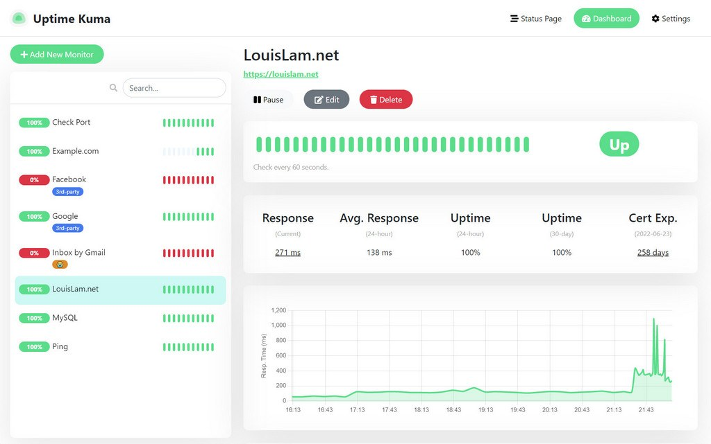

  

# 08 进阶：从"会用"到"省心"

> ⏱ 大约 70 分钟 · 难度 ⭐⭐⭐⭐

  

> 💡 真实界面截图来自 [github.com](https://github.com/louislam/uptime-kuma)，见 [致谢](../../CREDITS.md)。

## 什么时候该读这一章

当你的 NAS 已经稳定运行，你开始冒出这些念头：

- "每次装服务都要手动点一遍，能不能自动？"
- "机器到底累不累？硬盘还好吗？我想看得见。"
- "为什么传文件还是不够快？瓶颈在哪？"

恭喜，你已经从"用户"变成"管理者"了。这一章就是给这个阶段的你写的。

## 进阶不是"装更多东西"

先泼一盆冷水：进阶不等于把机器塞满服务。

真正的进阶是——**让系统更可控、更省心、更可预测**。每引入一个工具之前，先问自己一句：它解决了什么实际问题？如果答案模糊，那就先别装。

那张小机器人园丁的配图，画的就是这个意思：让一切井井有条，自己在旁边安心喝茶。

## 五个主题

| 小节 | 解决什么 |
| --- | --- |
| [8.1 虚拟机与容器](8.1-虚拟机与容器.md) | 什么时候用 VM，什么时候用容器 |
| [8.2 Ansible 自动化](8.2-Ansible自动化运维.md) | 用代码代替手点，配置可复现 |
| [8.3 性能调优](8.3-性能调优.md) | 先测量再优化，别瞎折腾 |
| [8.4 能耗优化](8.4-能耗优化.md) | 省电与可用的平衡 |
| [8.5 监控告警](8.5-监控与告警.md) | 出问题第一时间知道 |

## 自动化的意义

这里想特别说说 Ansible。

把它理解成"录音版的你"——你把平时手动敲的命令、点的按钮，写成一份剧本（Playbook），以后让它自动照做。好处是：不会漏步骤、换台机器也能重来、改了什么都有记录。

这种"用代码定义 NAS"的思路，正是 [Ansible-NAS](https://github.com/) 这类开源项目的核心理念。

## 小练习

翻到 [exercises/08-进阶主题.md](../../exercises/08-进阶主题.md)。别贪多，从写一个最简单的 Playbook 或配一个监控项开始。
