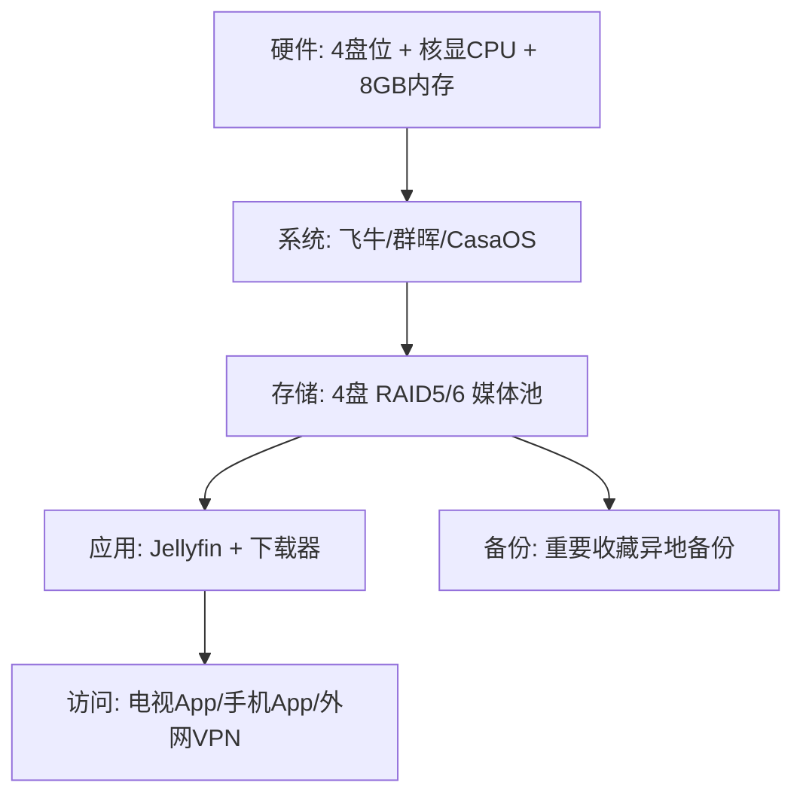
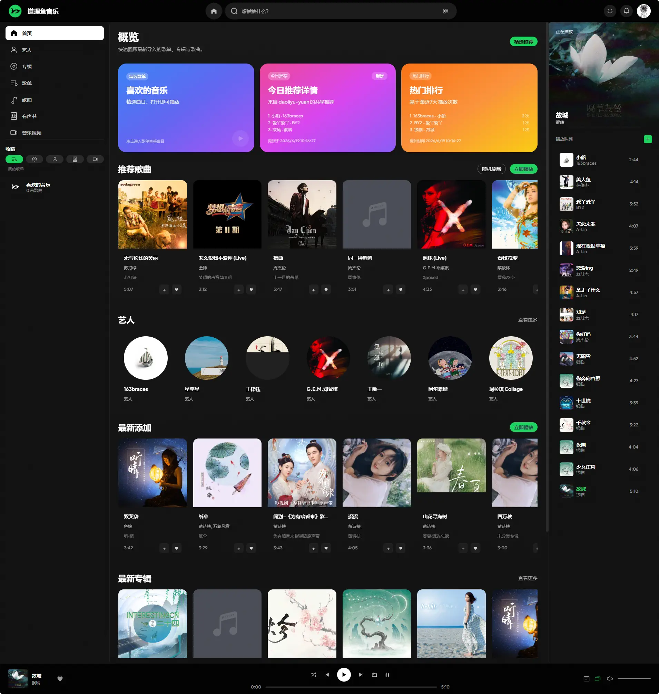

# 9.1 家庭影音中心

> 场景：把家里的影片、剧集、音乐整理成漂亮的媒体库，在电视/手机/平板上随时观看。

## 先说说这个场景

张先生攒了十几年的电影和剧集，散在好几块硬盘里。每次想看片，都得翻箱倒柜找是哪块盘——那种感觉，就像明明有一屋子书，却找不到想读的那一本。

他的愿望其实很朴素：电视上能像点流媒体一样选片，手机在外面也能连着看，再也不用抱着 U 盘来回倒。

## 他们到底需要什么

| 需求 | 对应章节 |
| --- | --- |
| 大容量存储 | [2.2 硬盘选型](../02-硬件选型/2.2-硬盘选型.md) |
| 电视/手机多端播放 | [7.2 影音中心](../07-应用服务/7.2-影音中心.md) |
| 4K 流畅播放 | [2.1 核心部件选型](../02-硬件选型/2.1-核心部件选型.md) 硬件转码 |
| 外网访问 | [6.2 远程访问](../06-网络与远程访问/6.2-远程访问方案对比.md) |
| 数据别丢 | [5.4 备份](../05-存储与数据保护/5.4-备份3-2-1原则.md) |

## 方案怎么定

**硬件建议**：主流甜点档（见 [2.4](../02-硬件选型/2.4-整机方案与预算.md)），带核显 CPU 用于 4K 转码，2.5G 网口更从容。

**系统建议**：追求易用选飞牛/群晖；追求自由选 CasaOS/TrueNAS。

## 一步步做

1. **搭建硬件与系统**：按 [第 4 章](../04-第一次搭建/README.md) 装好系统
2. **创建媒体存储池**：按 [5.2](../05-存储与数据保护/5.2-RAID与存储池实战.md)，大容量盘推荐 RAID 6
3. **整理媒体库**：按规范命名，建立 movies / tvshows / music 目录
4. **部署 Jellyfin**：见 [7.2](../07-应用服务/7.2-影音中心.md)，映射媒体目录与 `/dev/dri`。在飞牛的应用中心里，像 Jellyfin 这类应用可以直接搜到一键安装：

   

     
   

5. **配置刮削**：设置中文元数据来源，让它自动补海报与剧集信息
6. **部署下载器**：见 [7.3](../07-应用服务/7.3-下载与同步.md)，下载目录指向媒体库
7. **配置访问**：电视装 Jellyfin 客户端；外网用 Tailscale，见 [6.2](../06-网络与远程访问/6.2-远程访问方案对比.md)
8. **配置备份**：媒体可再下载，但珍贵的自制视频要进 3-2-1 备份

## 验收清单

- [ ] 电视上能流畅播放 4K（优先直播）
- [ ] 海报、剧集信息刮削正确
- [ ] 手机外网通过 VPN 能访问
- [ ] 下载器文件自动进入媒体库
- [ ] 重启后 Jellyfin 配置与库都在（数据持久化正确）

## 常见问题

- **刮削不到中文信息**：换元数据源或手动编辑命名
- **转码卡顿**：确认硬件转码已启用；否则升级带核显 CPU
- **外网慢**：家庭上传带宽有限，正常现象

## 写在最后

影音中心的关键：核显转码 + 规范媒体库 + Jellyfin + VPN 外网访问。媒体可再获取，但珍贵内容仍需备份。

## 动手试试

1. 按本案例规划你的影音中心配置清单。
2. 整理 10 部影片并部署 Jellyfin，验证刮削与播放。
