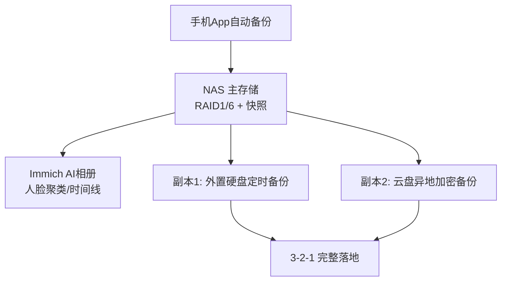

# 9.2 家庭备份与照片库

  

> 场景：安全备份全家的照片和视频，建一个能人脸聚类、随时回顾的私有相册。

## 场景描述

李女士担心手机里的孩子照片会丢，也想把父母的老照片数字化保存。她希望：手机自动备份、家人都能看、数据哪怕设备坏了也不丢。

## 需求分析

| 需求 | 对应章节 |
| --- | --- |
| 手机自动备份 | [7.4 私有云与相册](../07-应用服务/7.4-私有云与相册.md) |
| AI 相册/人脸聚类 | [7.4](../07-应用服务/7.4-私有云与相册.md) Immich |
| 数据安全不丢 | [第 5 章](../05-存储与数据保护/README.md) |
| 家人多用户访问 | [4.3 初始化配置](../04-第一次搭建/4.3-初始化配置.md) |

## 方案设计

> 💡 这个案例的重点不是"能看照片"，而是"数据真的丢不了"。

## 实施步骤

1. **搭建 NAS 并建立用户**：见 [第 4 章](../04-第一次搭建/README.md)，为家人各建账号
2. **创建照片存储池**：RAID 1（双盘）或 RAID 6（多盘），见 [5.2](../05-存储与数据保护/5.2-RAID与存储池实战.md)
3. **部署 Immich**：见 [7.4](../07-应用服务/7.4-私有云与相册.md)，配置手机 App 自动备份（仅 WiFi）
4. **导入老照片**：扫描件按日期整理，批量导入
5. **设置快照**：为照片目录设置每日快照，见 [5.3](../05-存储与数据保护/5.3-快照与版本管理.md)
6. **建立异地备份**：用 Hyper Backup / restic 加密后同步到云盘，见 [5.4](../05-存储与数据保护/5.4-备份3-2-1原则.md)
7. **建立冷备**：外置硬盘定期同步，存放于别处
8. **验证恢复**：从备份恢复一张测试照片，见 [5.4](../05-存储与数据保护/5.4-备份3-2-1原则.md)

## 验收清单

- [ ] 手机拍照后 WiFi 环境自动备份成功
- [ ] Immich 时间线、人脸聚类正常
- [ ] 家人账号只能访问被授权的相册
- [ ] 快照每日生成，可恢复误删照片
- [ ] 云盘上有加密备份，且做过恢复演练
- [ ] 硬盘健康监控与告警已开启，见 [5.5](../05-存储与数据保护/5.5-硬盘健康监控.md)

## 特别提醒

> ⚠️ 照片是不可再生的。请把预算优先给**可靠的硬盘 + 真正的异地备份**，而不是华丽的界面。RAID 和快照都不能替代异地备份。

## 写在最后

家庭照片库 = 自动备份 + AI 相册 + 快照 + 3-2-1 备份。数据在、能找回，才是这个案例的核心目标。

## 动手试试

1. 画出你家照片的 3-2-1 备份架构图。
2. 做一次完整的恢复演练：删除测试照片 → 从快照恢复 → 从备份恢复。
