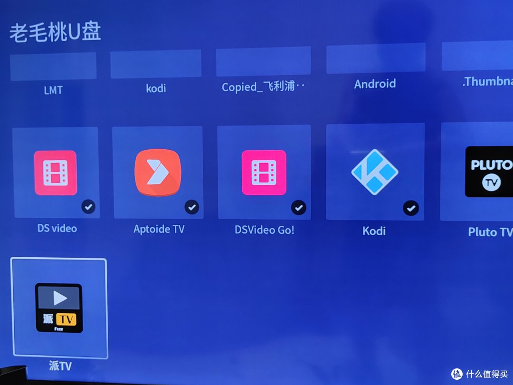

# 9.2 家庭备份与照片库：把回忆稳稳留住

> 场景：把全家照片和视频安全存起来，建一个能人脸聚类、随时回顾的私有相册。

## 先说说这个场景

李女士有个烦恼：手机里全是孩子的照片，可她总怕哪天手机丢了、坏了，这些就没了。

父母的老照片也散在各处——有些在旧电脑里，有些还是纸质的。她想把这一切都数字化、集中起来，让家人都能看，而且**哪怕设备坏了也丢不了**。

这个案例的重点，不是"能看照片"，而是那句加粗的话——**数据真的丢不了**。

## 他们到底需要什么

| 需求 | 对应章节 |
| --- | --- |
| 手机自动备份 | [7.4 私有云与相册](../../docs/07-应用服务/7.4-私有云与相册.md) |
| AI 相册、人脸聚类 | [7.4](../../docs/07-应用服务/7.4-私有云与相册.md) 的 Immich |
| 数据安全不丢 | [第 5 章](../../docs/05-存储与数据保护/README.md) |
| 家人多用户访问 | [4.3 初始化配置](../../docs/04-第一次搭建/4.3-初始化配置.md) |

## 方案怎么定

硬件不用顶级，但要稳：2 盘位 RAID 1，或者 4 盘位 RAID 6。硬盘选 NAS 专用盘，见 [2.2](../../docs/02-硬件选型/2.2-硬盘选型.md)。

群晖自带的 Photo Station 也是常见的相册方案，界面长这样：

  

> 💡 截图来自 [什么值得买的群晖教程](https://post.smzdm.com/p/agq0p693/)（见 [致谢](../../CREDITS.md)）。

## 一步步做

1. **搭系统、建用户**：按 [第 4 章](../../docs/04-第一次搭建/README.md)，给家人各建账号
2. **建照片存储池**：RAID 1（双盘）或 RAID 6（多盘），见 [5.2](../../docs/05-存储与数据保护/5.2-RAID与存储池实战.md)
3. **部署 Immich**：见 [7.4](../../docs/07-应用服务/7.4-私有云与相册.md)，手机 App 开自动备份（仅 WiFi）
4. **导入老照片**：扫描件按日期整理，批量导入
5. **设快照**：照片目录每天快照，见 [5.3](../../docs/05-存储与数据保护/5.3-快照与版本管理.md)
6. **建异地备份**：用 Hyper Backup 或 restic 加密后传到云盘，见 [5.4](../../docs/05-存储与数据保护/5.4-备份3-2-1原则.md)
7. **加冷备**：外置硬盘定期同步，放在别处
8. **验证恢复**：从备份恢复一张测试照片，见 [5.4](../../docs/05-存储与数据保护/5.4-备份3-2-1原则.md)

## 验收清单

- [ ] 手机拍照后，WiFi 环境能自动备份
- [ ] Immich 时间线、人脸聚类正常
- [ ] 家人账号只能看到被授权的相册
- [ ] 快照每天生成，误删能找回
- [ ] 云盘有加密备份，且做过恢复演练
- [ ] 硬盘健康监控和告警已开启，见 [5.5](../../docs/05-存储与数据保护/5.5-硬盘健康监控.md)

## 一句掏心窝的话

> ⚠️ 照片是不可再生的。请把预算优先给**可靠的硬盘 + 真正的异地备份**，而不是华丽的界面。RAID 和快照都不能替代异地备份——这句话我们在 [5.4](../../docs/05-存储与数据保护/5.4-备份3-2-1原则.md) 说过，这里再说一遍。

## 写在最后

家庭照片库 = 自动备份 + AI 相册 + 快照 + 3-2-1 备份。数据在、能找回，才是这个案例真正的核心。

## 动手试试

1. 画出你家照片的 3-2-1 备份架构图。
2. 做一次完整恢复演练：删掉测试照片 → 从快照恢复 → 从备份恢复。
