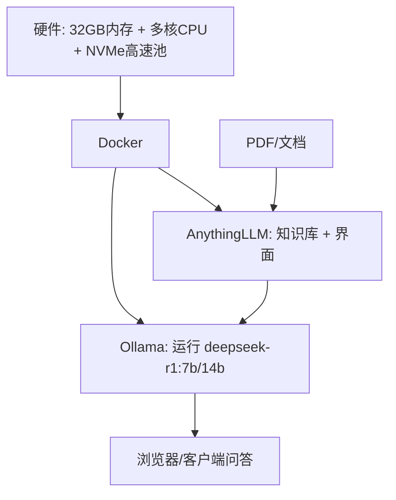

# 9.3 个人 AI 工作站

  

> 场景：在 NAS 上跑本地大模型（如 DeepSeek 蒸馏版），搭建私有知识库，断网也能问答。

## 场景描述

王先生是开发者，想用 AI 帮他整理技术文档、分析合同，但不希望敏感内容上传到云端。他有一台 32GB 内存的 NAS，想把它变成私有 AI 工作站。

## 需求分析

| 需求 | 对应章节 |
| --- | --- |
| 大内存 + 快盘 | [2.1 核心部件选型](../02-硬件选型/2.1-核心部件选型.md) |
| Docker 部署 | [7.1 Docker 基础](../07-应用服务/7.1-Docker基础.md) |
| 本地模型运行 | [7.5 自托管 AI](../07-应用服务/7.5-自托管AI.md) |
| 知识库 RAG | [7.5](../07-应用服务/7.5-自托管AI.md) AnythingLLM |
| 性能保障 | [8.3 性能调优](../08-进阶主题/8.3-性能调优.md) |

## 方案设计

## 实施步骤

1. **确认硬件**：32GB 内存可尝试 14B 模型；SSD/NVMe 放模型文件加速加载
2. **创建高速存储池**：用 NVMe 建池，见 [5.1](../05-存储与数据保护/5.1-文件系统.md)
3. **部署 Ollama**：见 [7.5](../07-应用服务/7.5-自托管AI.md)，映射模型目录到高速池
4. **拉取模型**：从 7B 蒸馏模型起步（如 `deepseek-r1:7b`）
5. **部署 AnythingLLM**：配置连接 Ollama，创建工作区
6. **导入文档**：上传 PDF/文档，构建知识库（RAG）
7. **配置访问**：内网直接用；公网务必加认证 + HTTPS + VPN，见 [6.4](../06-网络与远程访问/6.4-HTTPS与证书.md)
8. **资源限制**：为容器设置内存上限，避免拖垮其他服务，见 [8.3](../08-进阶主题/8.3-性能调优.md)

## 验收清单

- [ ] Ollama 能正常运行模型并响应问答
- [ ] AnythingLLM 能基于上传的文档回答问题
- [ ] 断网后仍能问答（验证本地性）
- [ ] AI 服务有认证保护，未裸奔公网
- [ ] 运行时其他服务（如下载、影音）未受明显影响

## 风险提示

> ⚠️ 1. 小模型会"幻觉"，重要结论请核实。
> ⚠️ 2. AI 容器资源占用高，务必限制与监控。
> ⚠️ 3. 知识库文档可能敏感，注意访问控制与备份。
> ⚠️ 4. GPU 直通能大幅加速，但配置复杂，按需考虑。

## 写在最后

个人 AI 工作站 = 足够内存 + Ollama + 前端知识库。从 7B 模型起步，注意资源与安全防护，逐步升级。

## 动手试试

1. 评估你的硬件能跑多大的模型，写下模型选择。
2. 部署 Ollama + AnythingLLM，导入 3 份文档，测试知识库问答效果。
