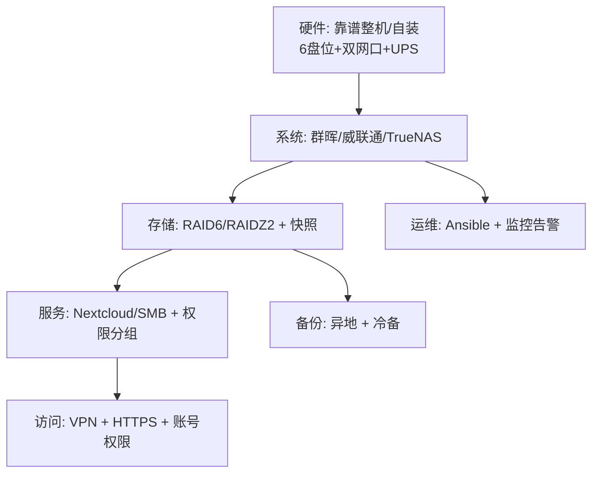

# 9.4 小型办公室 NAS

> 场景：为 5～20 人的小团队搭建文件共享、协作与备份中心。

## 先说说这个场景

一家十来人的设计公司，项目文件散在每个员工的电脑里。找一版设计稿要在群里喊半天，"最终版""最终版2""真的最终版"堆了一堆。

老板想要一个集中的地方放文件、分权限、还能防丢——但公司没有专职 IT，所以这套东西必须**稳定、省心、好维护**。

## 他们到底需要什么

| 需求 | 对应章节 |
| --- | --- |
| 多用户权限管理 | [4.3 初始化配置](../04-第一次搭建/4.3-初始化配置.md) |
| 稳定与数据安全 | [第 5 章](../05-存储与数据保护/README.md) |
| 远程/分支访问 | [第 6 章](../06-网络与远程访问/README.md) |
| 协作与同步 | [7.4 私有云](../07-应用服务/7.4-私有云与相册.md) Nextcloud |
| 可维护、可恢复 | [8.2 Ansible](../08-进阶主题/8.2-Ansible自动化运维.md)、[8.5 监控](../08-进阶主题/8.5-监控与告警.md) |

## 方案怎么定

**硬件建议**：6 盘位以上、双网口（链路聚合）、ECC 内存更佳、配 UPS 防断电。见 [2.4](../02-硬件选型/2.4-整机方案与预算.md)、[2.1](../02-硬件选型/2.1-核心部件选型.md)。

**系统建议**：重视省心与售后选群晖/威联通；重视数据安全与自主可控选 TrueNAS。

## 一步步做

1. **规划用户与权限结构**：按部门建组（设计、财务、管理），最小权限
2. **搭建硬件与系统**：见 [第 4 章](../04-第一次搭建/README.md)
3. **创建存储池**：RAID 6 / RAIDZ2，见 [5.2](../05-存储与数据保护/5.2-RAID与存储池实战.md)
4. **建立共享目录与配额**：按项目/部门划分，见 [4.3](../04-第一次搭建/4.3-初始化配置.md)
5. **部署协作服务**：Nextcloud 或 SMB 文件服务，见 [7.4](../07-应用服务/7.4-私有云与相册.md)
6. **配置远程访问**：VPN + HTTPS，见 [第 6 章](../06-网络与远程访问/README.md)
7. **建立备份**：异地备份 + 冷备 + 快照，见 [第 5 章](../05-存储与数据保护/README.md)
8. **自动化与监控**：Ansible 管理配置、Uptime Kuma 监控，见 [8.2](../08-进阶主题/8.2-Ansible自动化运维.md)、[8.5](../08-进阶主题/8.5-监控与告警.md)
9. **制定制度**：账号开通/回收流程、备份演练计划、故障响应流程

## 验收清单

- [ ] 不同部门只能访问授权目录
- [ ] 离职员工账号可即时停用
- [ ] 远程员工通过 VPN 安全访问
- [ ] 每日快照 + 异地备份正常，且做过恢复演练
- [ ] 监控告警能及时通知管理员
- [ ] 有书面运维与应急文档

## 特别提醒

> ⚠️ 办公场景的"数据 + 制度"比"功能"更重要。技术上做好权限与备份的同时，别忘了账号管理和恢复演练这些流程。

## 写在最后

办公室 NAS 的重点是：可靠硬件 + 清晰权限 + 完善备份 + 可运维。技术上做到位，制度上也要跟上。

## 动手试试

1. 为一个 10 人团队设计用户组与共享目录的权限矩阵。
2. 写出一份简单的"NAS 运维与应急 checklist"。
