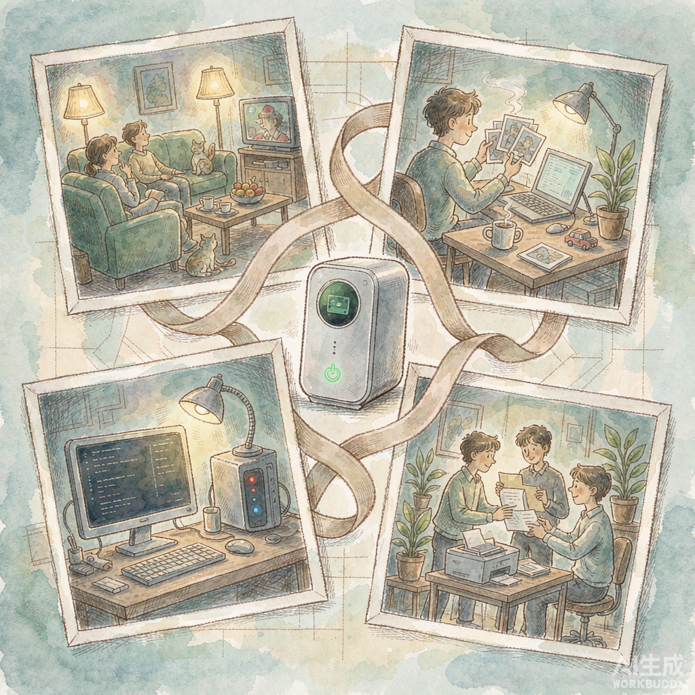

  

# 09 实战案例：把前面的知识，拼成一个成品

> ⏱ 按场景选读 · 难度 ⭐⭐⭐ · 要动手

## 这一章不一样

前面八章，我们是一块一块地讲零件。这一章，我们把零件拼成四台完整的机器——或者说，四个完整的生活场景。

它们分别是：

| 案例 | 一句话 | 适合谁 |
| --- | --- | --- |
| [9.1 家庭影音中心](9.1-家庭影音中心.md) | 客厅里的私人影院 | 爱看片、有收藏的人 |
| [9.2 家庭备份与照片库](9.2-家庭备份与照片库.md) | 把回忆稳稳留住 | 有娃、有老人、珍惜照片的人 |
| [9.3 个人 AI 工作站](9.3-个人AI工作站.md) | 在家里问自己的文档 | 在意隐私、爱折腾的开发者 |
| [9.4 小型办公室 NAS](9.4-小型办公室NAS.md) | 十个人的文件中枢 | 小团队、工作室 |

## 怎么用这一章

每个案例都按同一个骨架写：

**场景描述 → 需求分析 → 方案设计 → 实施步骤 → 验收清单**

遇到不懂的概念，正文里会提示你回查哪一章。你可以把它当成"项目说明书"，照着做就行。

## 这些案例都不唯一

先说清楚：案例是**参考方案，不是标准答案**。

你的预算、设备、家里网络状况都不一样。照搬配置单未必合适。正确的用法是：

1. 看它的**思路**（为什么这么选）
2. 换成**你的条件**（你有什么设备、多少钱）
3. 保留它的**验收清单**（确认自己真的做对了）

## 关于那张配图

本章开头那张手绘图，把四个场景用一条丝带串在一起——家庭影院、备份照片、AI 工作站、办公室协作。

它们看似不同，背后其实是同一台小盒子，和同一套思路。这也是我们写这本书想传达的：**技术是一样的，变的只是你想用它做什么。**

## 小练习

翻到 [exercises/09-实战案例.md](../../exercises/09-实战案例.md)，做一个属于你的方案。从需求分析到验收，完整走一遍。做完了，你就真正"出师"了。
