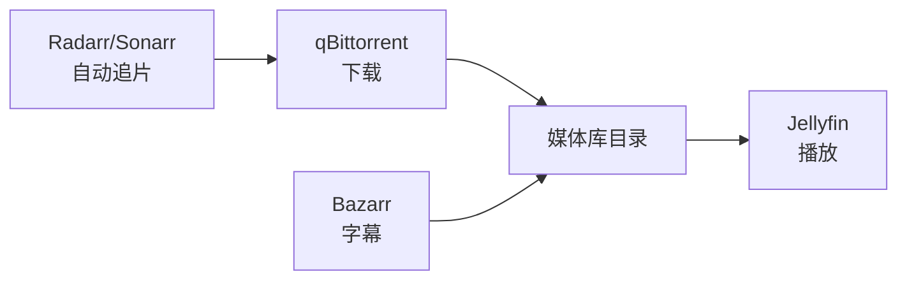

# 10.2 影音、阅读与音乐类

> 这一节逛什么：把 NAS 变成家庭娱乐中心的各种玩法

## 影音（第 7 章的 Jellyfin 之外）

| 应用 | 特点 | 适合 |
| --- | --- | --- |
| **Jellyfin** | 免费开源，社区活跃（已在 7.2 讲） | 大多数家庭 ✅ |
| **Emby / Plex** | 体验成熟，部分功能付费 | 愿意付费换省心 |
| **Kodi + 插件** | 放在电视端，配合 NAS 使用 | 客厅播放 |
| **TMM（TinyMediaManager）** | 整理、刮削媒体库元数据 | 片库整理强迫症 |

> 💡 有个经验：影片管理的痛点往往不是"播放器"，而是"命名和整理"。用 TMM 之类的工具先把片子整理规范，播放体验会好一大截。

## 音乐

| 应用 | 特点 |
| --- | --- |
| **Navidrome** | 轻量音乐服务器，Web UI 漂亮，支持 Subsonic 协议 |
| **Airsonic-Advanced** | Subsonic 系的成熟方案 |
| **Lidarr** | 音乐收集自动化（和 Sonarr 同family） |
| **Koel** | 界面现代的音乐流媒体 |

> 💡 想听自己的音乐收藏又不想给各平台交会员？Navidrome + 手机 Subsonic 客户端是很舒服的组合。

## 电子书与阅读

| 应用 | 特点 |
| --- | --- |
| **Calibre-Web** | 管理电子书库，网页阅读，配合 Calibre 使用 |
| **KOReader** | 强大的电子书阅读器（多在设备上用） |
| **Kavita** | 漫画/电子书服务器，界面现代 |
| **Komga** | 专注漫画管理 |

## 下载与自动化（媒体获取）

| 应用 | 特点 |
| --- | --- |
| **qBittorrent / Transmission** | BT 下载（已在 7.3 讲） |
| **Sonarr** | 自动追剧（剧集下载自动化） |
| **Radarr** | 自动追电影 |
| **Bazarr** | 自动下载字幕 |
| **Jackett / Prowlarr** | 聚合种子站点索引，配合上面几个用 |

> ⚠️ 这些工具本身是合法的，但**请只用于获取你有权获取的内容**，遵守当地法律法规。

## 一个常见的组合

这套组合是很多 homelab 玩家的标配：新剧上线自动下载、自动补字幕、自动进片库，你在电视上直接就能看。

> 💡 参考 [TechHutTV/homelab](https://github.com/TechHutTV/homelab) 与 [SinghChinmayy/homelab](https://github.com/SinghChinmayy/homelab) 等项目，它们都用 Docker Compose 编排了类似的媒体自动化栈。

## 写在最后

影音娱乐的核心还是第 7 章那套。这一节是给你"还能加什么"的地图——音乐、电子书、自动化追片，按需取用。

## 动手试试

1. 你最想解决的是"看片""听歌"还是"看书"？写下对应的一两个应用。
2. 如果你有音乐收藏，试试 Navidrome，用手机连一下。
