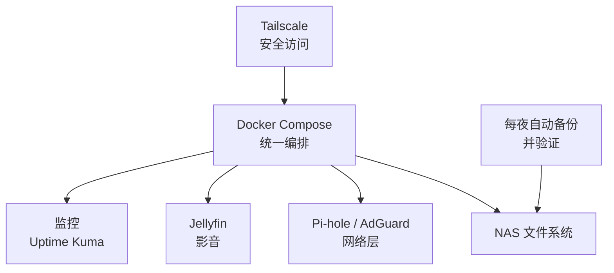

  

# 10.4 家庭、网络与工具类

> 这一节逛什么：让 NAS 顺手管起家里的网络和小事

## DNS 与广告过滤

| 应用 | 特点 |
| --- | --- |
| **AdGuard Home** | 网络级广告过滤 + DNS，界面友好 ✅ |
| **Pi-hole** | 老牌 DNS 广告过滤，轻量 |
| **Technitium DNS** | 功能强大的 DNS 服务器 |

> 💡 装一个 AdGuard Home，全家设备的广告都在 DNS 层拦掉，是"装完立刻能感受到"的服务之一。注意别和自己已有的 DNS 服务冲突。

## 反向代理与网络入口

| 应用 | 特点 |
| --- | --- |
| **Nginx Proxy Manager** | 图形化反代（已在 6.3 讲） |
| **Traefik** | 自动发现容器，配置即代码 |
| **Caddy** | 配置极简，自动 HTTPS |
| **Cloudflared** | 内网隧道（已在 6.2 讲） |

## 远程访问与组网

| 应用 | 特点 |
| --- | --- |
| **Tailscale / Headscale** | Mesh VPN，自建控制端用 Headscale |
| **WireGuard** | 高性能 VPN |
| **ZeroTier** | 另一种组网方案 |

> 💡 这几个在 [6.2 远程访问](../06-网络与远程访问/6.2-远程访问方案对比.md) 讲过。一句话：家庭 NAS 远程访问首选这类组网 VPN，而不是端口转发。

## 智能家居

| 应用 | 特点 |
| --- | --- |
| **Home Assistant** | 智能家居中枢，能和 NAS 上的服务联动 ✅ |
| **OpenHAB** | 另一种智能家居平台 |
| **Node-RED** | 可视化自动化编排 |

> 💡 Home Assistant 常被 homelab 玩家装在 NAS 上（容器或虚拟机），把影音、监控、智能设备串起来。参考 [mikeroyal/Self-Hosting-Guide](https://github.com/mikeroyal/Self-Hosting-Guide) 的智能家居分类。

## 自动化与运维

| 应用 | 特点 |
| --- | --- |
| **n8n** | 强大的工作流自动化，能连各种服务 |
| **Homepage / Heimdall** | 自建导航页，把所有服务收进一个仪表盘 |
| **Portainer** | 容器管理界面 |
| **Uptime Kuma** | 服务监控（已在 8.5 讲） |
| **Grafana + Prometheus** | 专业监控可视化 |

> 💡 Homepage 这类仪表盘是"面子工程"里最实用的一种——把所有服务的入口和状态放一页，家人也能用。

## 一个 homelab 样板的结构

参考 [kimzam30/my-homelab-setup](https://github.com/kimzam30/my-homelab-setup) 和 [jbaznik/homelab](https://github.com/jbaznik/homelab_codeasashu) 这类真实项目，一个典型的家庭服务器会这样组织：

注意两个细节：一是**用 Tailscale 把入口收住**，二是**备份要自动且验证**——这正是这些项目反复强调的。

## 写在最后

这类服务的共同点：不炫技，但装了就离不开。AdGuard Home + Homepage + 一个监控，是很实用的"起步三件套"。

## 动手试试

1. 如果你想先装一个"立刻有感"的服务，试试 AdGuard Home。
2. 逛一下 Homepage 的配置，想想把你的服务收进一个仪表盘。
