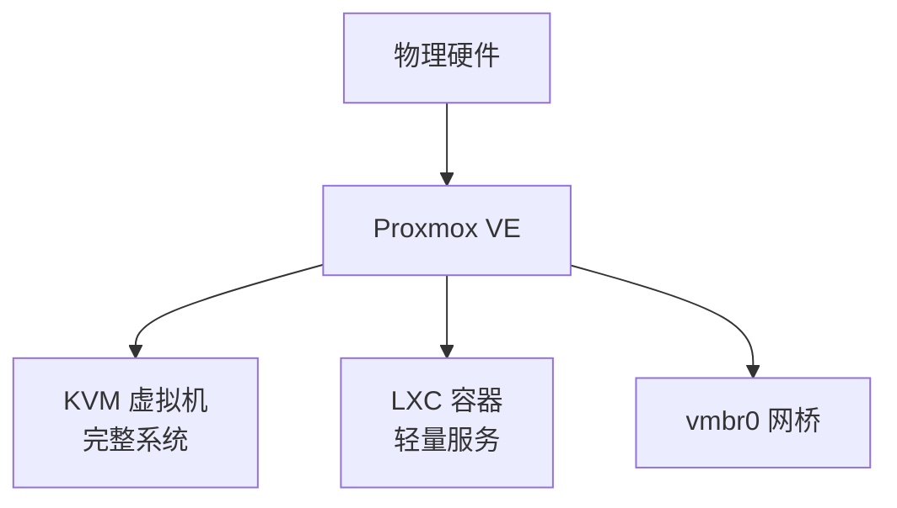

  

# 11.1 PVE 是什么，和容器有什么不一样

## 先认识一下

Proxmox VE（简称 PVE）是一个基于 Debian 的开源虚拟化平台。它把一台物理服务器变成能跑多台虚拟机的"宿主机"，通过 Web 界面管理。

它支持两种虚拟化：

- **KVM 虚拟机**：完整的虚拟机，能跑任何系统（包括把 NAS 系统装进去）
- **LXC 容器**：轻量容器，共享内核，适合跑各种服务

## 几个核心概念

参考 [PVE 中文手册](https://pve-doc-cn.readthedocs.io/) 的术语，先认识几个词：

| 概念 | 大白话 |
| --- | --- |
| 节点 Node | 一台物理服务器 |
| 集群 Cluster | 多台节点连起来统一管理 |
| 虚拟机 VM | 完整模拟的电脑 |
| LXC 容器 | 轻量的隔间 |
| 存储 Storage | 虚拟机磁盘文件放哪儿 |
| 网络桥接 vmbr0 | 虚拟机共享的虚拟交换机 |
| PCI 直通 | 把物理硬件（硬盘控制器、显卡）直接给某台虚拟机 |

## 和 Docker 容器有什么不同

这点容易混：

| 维度 | PVE 的虚拟机 | Docker 容器 |
| --- | --- | --- |
| 隔离 | 完整硬件级 | 进程级 |
| 系统 | 能跑不同系统 | 共享宿主内核 |
| 用途 | 跑完整 NAS 系统、其它 OS | 跑单个应用 |
| 开销 | 大 | 小 |

简单说：**PVE 管的是"多台电脑"，Docker 管的是"多个应用"。** 它们是不同层级的东西——你甚至可以在 PVE 的虚拟机里再跑 Docker。见 [8.1 虚拟机与容器](../08-进阶主题/8.1-虚拟机与容器.md)。

## 硬件要求

- CPU 支持虚拟化（VT-x / AMD-V）——现在大部分都支持
- 想做 PCIe 直通还要 IOMMU（VT-d / AMD-Vi）
- 内存要够分给几台虚拟机
- 至少一块装 PVE 的盘（建议 SSD）

> 💡 安装时 BIOS 里要开虚拟化支持、关安全启动（Secure Boot），和装飞牛/OMV 类似。有份[实践记录](https://www.kufanyun.com/ask/853285.html)提到：PVE 装好后访问 `https://IP:8006`，建议先把软件源换成国内镜像（如清华源）。

## 写在最后

PVE 是"管理的上层"——它让你在一台机器上跑很多系统。理解这一点，下一节讲"把 NAS 装进去"就顺了。

## 动手试试

1. 查你的 CPU 型号是否支持 VT-x/AMD-V 和 VT-d/AMD-Vi。
2. 说清楚 PVE 虚拟机和 Docker 容器的区别。
