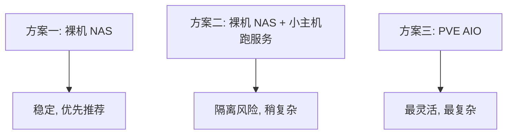
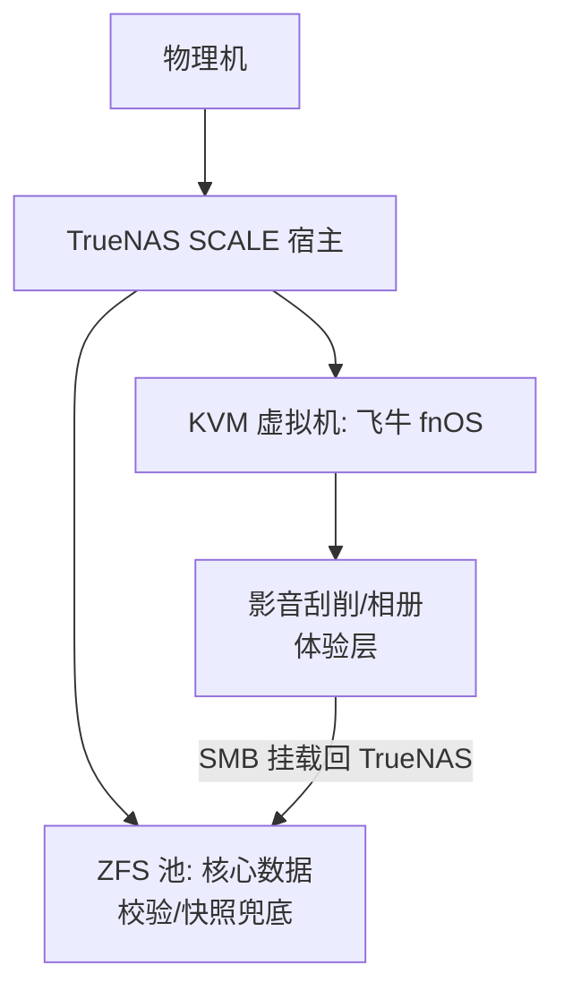

# 11.3 该不该 All in One

## 先把利弊摆清楚

AIO（All in One，一台机器跑所有东西）听着很美，但它是把双刃剑。

| 好处 | 代价 |
| --- | --- |
| 一台机器搞定所有需求 | 故障影响面大——宿主机挂了全挂 |
| 资源利用率高 | 复杂度陡增，排障困难 |
| 快照/迁移方便 | 直通配置容易踩坑 |
| 学习价值高 | 升级/维护要停机，家人可能抱怨 |

> ⚠️ 最现实的风险：你在虚拟机里跑 NAS，某天 PVE 更新出问题或宿主机宕机，**全家的数据访问、影音、下载同时中断**。裸机装 NAS 时，至少 NAS 本身不受虚拟化层影响。

## 什么情况下值得 AIO

- 你有一台性能过剩的机器，闲置可惜
- 你想同时跑 NAS + 软路由 + 智能家居 + 各种虚拟机
- 你有时间折腾，出问题能自己排查
- 你**已经做好了独立的备份**（这条是前提）

## 什么情况下别碰

- 你是 NAS 新手，还没把基础玩明白
- 家里人依赖 NAS，不能接受长时间中断
- 机器性能本来就紧张
- 你不想花时间研究直通、IOMMU、虚拟机网络

> 💡 一句大实话：很多人上了 AIO 后，最终又退回"裸机 NAS + 一台小机器跑服务"的方案。**简单往往更可靠。**

## 一个折中方案

如果你只是想多跑几个 Docker 服务，其实不必上 PVE——裸机 NAS 里的 Docker（第 7 章）就够了。

## 一个真实案例：TrueNAS 打底 + 飞牛做体验层

B 站 UP 主司波图有一条很受认可的视频，讲的正是这种"两个系统都要"的方案。我们把视频逐句转录后，提炼出他的核心思路和实操提醒（[视频 BV1gEfYBxE8V](https://www.bilibili.com/video/BV1gEfYBxE8V)，文字稿见 [`transcripts/`](../../transcripts/)）：

**思路：让每个系统干自己擅长的事**

- TrueNAS 在底层管存储：ZFS 的校验、ARC 缓存、快照，给核心数据兜底
- 飞牛作为虚拟机跑在上面，负责刮削、看片、相册这些"体验层"——毕竟这是飞牛的拿手好戏
- 飞牛的数据通过 SMB 挂回 TrueNAS 的 ZFS 池，再叠加定时快照，误删或系统崩溃能秒级回滚

**他强调的实操细节**

- 飞牛虚拟机内存**建议 8GB 起步**；系统盘镜像直接上传，数据盘单独准备
- GPU 直通不能在创建虚拟机那一步直接选，要在虚拟机的 **Devices 按钮**里单独加，加完飞牛才有"满血"的硬件转码
- 视频里特意提醒：**不要在创建虚拟机的向导里就把相册空间配好**，先建好虚拟机再说
- 他明确说：这套用法**没有和飞牛做任何合作**，只是思路分享；飞牛可以换成任何功能类似的系统的位置

**他最后的风险提醒（很重要）**

- 如果内网其他设备（比如软路由）安全没做足，或 QNAP/NAS 密码泄露，坏人可能**以飞牛为跳板**爆破——"那也就全部完蛋了"
- 反复强调：**切记不要把任何 NAS 的 Web 管理页面暴露到公网**，这是非常危险的行为（呼应 [6.5 安全加固](../06-网络与远程访问/6.5-安全加固.md)）

> 💡 这段是逐句看完视频后提炼的，不是凭简介改写。转录里"Ark 缓存"实为 ARC、"Chunas/QNAS"实为 TrueNAS，属语音识别误差，已更正。

## 如果决定上 AIO，守住这几条

1. **备份独立**：重要数据一定要有一份不在宿主机上（见 [5.4](../05-存储与数据保护/5.4-备份3-2-1原则.md)）
2. **先跑稳定再迁移**：新方案先在测试环境跑一段时间
3. **记录配置**：直通设置、网络规划都记下来，出问题能恢复
4. **别把管理界面暴露公网**：见 [6.5](../06-网络与远程访问/6.5-安全加固.md)
5. **留好回退路**：保留裸机安装的镜像，随时能退回

## 写在最后

AIO 是工具，不是目标。想清楚它解决你什么问题，再决定要不要上。对多数家庭用户，裸机 NAS 才是更稳的选择。

## 动手试试

1. 列出 AIO 对你的具体好处和具体风险，各写三条。
2. 判断你现在属于"值得上"还是"别碰"那一类，写下理由。
