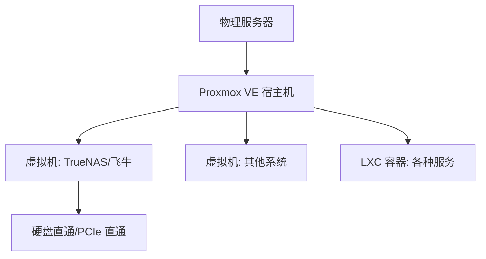

  

# 11 Proxmox VE 底层方案：把 NAS 装进虚拟机

> ⏱ 大约 45 分钟 · 难度 ⭐⭐⭐⭐ · 进阶玩法，量力而行

> 🖼️ **关于本章配图**
> PVE 的 Web 管理界面随版本和主题变化较大，且公开截图容易与实际版本不符，我们暂未放入。
>
> **替代方案**：本章用 Mermaid 架构图讲清虚拟化层次。需要真实界面时，建议直接看 [Proxmox VE 官方文档](https://pve.proxmox.com/pve-docs/) 的截图，或在测试机上装一个 PVE 自己看。
>
> 如果你想为本章贡献一张高质量真实截图，欢迎提 PR，详见 [贡献指南](../../CONTRIBUTING.md)。

## 这一章讲什么

前面我们都是"裸机装 NAS"——硬件上直接跑一个 NAS 系统。

但很多进阶玩家会反过来：**底层先装 Proxmox VE（PVE）这个虚拟化平台，然后把 NAS 当成一台虚拟机跑在里面**，同时还跑别的虚拟机和容器。这就是常说的 All in One（AIO）。

这一章不强迫你这么做，只是把这条路讲清楚。它适合"机器有余力、想在一台机器上跑很多东西、愿意折腾"的人。

> ⚠️ 先把丑话说前面：AIO 的故障影响面大——宿主机出问题，所有服务一起挂。家庭用户请务必先做好备份，再考虑这条路。

## 参考了什么

本章的组织思路参考了 [Proxmox VE 中文手册](https://pve-doc-cn.readthedocs.io/)（目录式、概念先行的文档结构）与 [TechHutTV/homelab](https://github.com/TechHutTV/homelab)（云原生 homelab 的项目组织方式），致谢见 [CREDITS](../../CREDITS.md)。

## 你会看到什么

| 小节 | 讲什么 |
| --- | --- |
| [11.1 PVE 是什么](11.1-PVE是什么.md) | 虚拟化平台基础概念 |
| [11.2 在 PVE 上装 NAS](11.2-在PVE上装NAS.md) | 直通、硬盘、网卡的关键点 |
| [11.3 该不该 All in One](11.3-该不该AIO.md) | 利弊与风险，帮你做决定 |

## 一句提醒

要跑虚拟机，CPU 需要支持虚拟化（Intel VT-x / AMD-V），做 PCIe 直通还要 VT-d / AMD-Vi。老机器可能不支持——先查清楚再决定。

## 写在最后

PVE + NAS 是强大但复杂的组合。不要因为"别人都在玩"就上，先想清楚它解决你什么问题。

## 动手试试

1. 查一下你的 CPU 是否支持虚拟化和 IOMMU（直通需要）。
2. 想想你现在的 NAS 负载，有没有必要上虚拟化。
