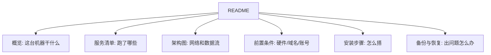

<p align="center">
  
</p>

# 12.1 一个 homelab 仓库长啥样

## 为什么要看仓库结构

一个组织良好的 homelab 仓库，本身就是一份"活文档"。它告诉你：

- 这台机器跑了哪些服务
- 每个服务的数据存在哪儿
- 网络怎么规划
- 出问题怎么恢复

看别人怎么组织，是建立自己体系的最短路径。

## 两种常见风格

参考 [northcutted/homelab](https://github.com/northcutted/homelab) 和 [truethari/home-lab](https://github.com/truethari/home-lab) 这类项目，大致有两种风格：

### 风格一：按功能分目录

```
homelab/
├── Compute-server/      # 计算节点配置
├── NAS/                 # NAS 相关配置
├── README.md
└── LICENCE.md
```

适合：服务多、分类清晰的场景。

### 风格二：单一主 Compose 文件

```
home-lab/
├── docker-compose.yml   # 所有服务在一个文件里
├── .env                 # 变量（不提交）
└── README.md
```

[truethari/home-lab](https://github.com/truethari/home-lab) 就是这种——一个 256GB 的小机器，所有服务用一个主 Compose 文件管理，强调"persistent storage and a single main docker-compose.yml"。适合：服务不多的家庭机器。

> 💡 没有绝对优劣。服务少时单文件简单；服务多时分目录清晰。关键是**你自己能看懂、能维护**。

## 一份好的 README 该写什么

参考这些项目的 README，好的说明通常包含：



特别提醒最后一条——[jbaznik/homelab](https://github.com/jbaznik/homelab_codeasashu) 这类项目会明确写出备份策略和恢复步骤，这是最值得学的部分。

## 数据持久化怎么体现

这些项目几乎都把数据目录统一规划，比如：

```
/mnt/
├── docker/          # 所有容器配置
│   ├── jellyfin/
│   ├── nextcloud/
│   └── ...
├── media/           # 影音数据
└── backup/          # 备份
```

一眼就能看出"配置在哪、数据在哪、备份在哪"。这比每个容器随手建个目录强太多。呼应 [7.1 Docker 基础](../07-应用服务/7.1-Docker基础.md) 里的数据持久化原则。

## 写在最后

仓库结构没有标准答案，但"清晰、可维护、有恢复说明"是共同点。看几个真实项目，找到适合你的组织方式。

## 动手试试

1. 打开一个参考项目，画出它的目录结构图。
2. 想想你的 NAS 数据目录，能不能整理成"配置/数据/备份"三分法。
