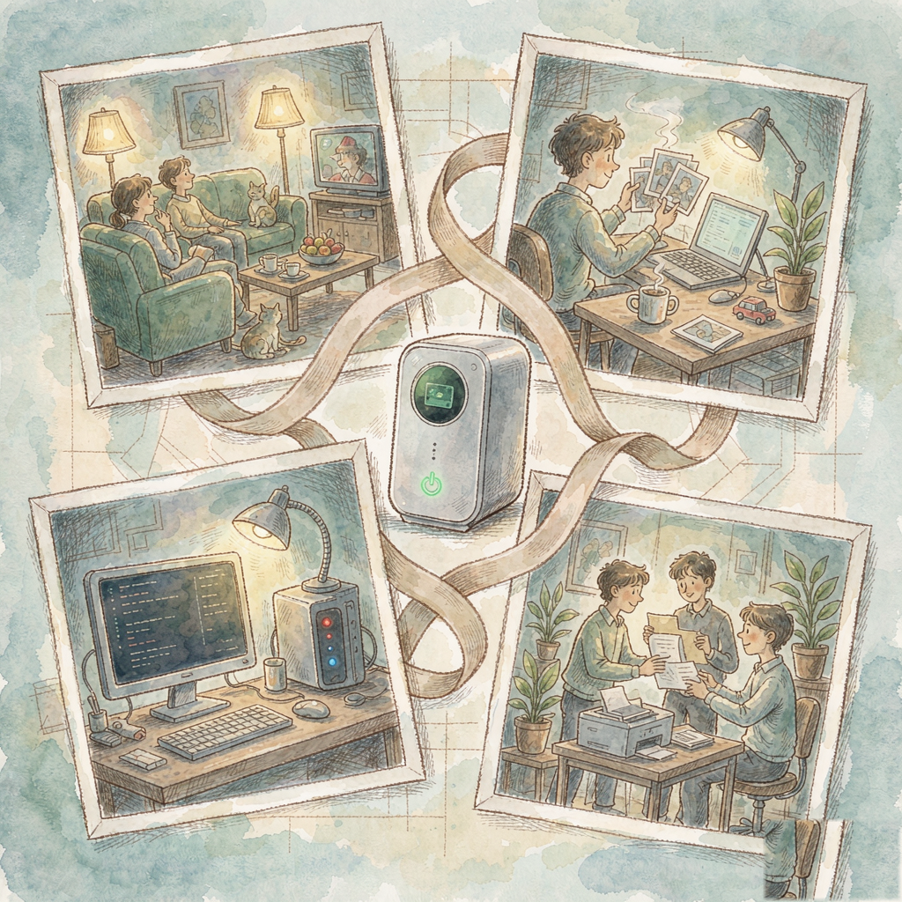
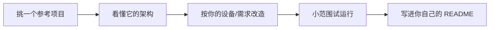

<p align="center">
  
</p>

# 12.3 搭你自己的样板

## 从模仿开始

看了一堆别人的项目，怎么变成自己的？

不用从零设计。挑一个最接近你需求的参考项目，把它"翻译"成你的版本：



## 第一步：挑参考

- 服务少 → 参考单 Compose 文件风格（[truethari/home-lab](https://github.com/truethari/home-lab)）
- 服务多 → 参考分目录风格（[northcutted/homelab](https://github.com/northcutted/homelab)）
- 重影音 → 参考媒体自动化项目（[SinghChinmayy/homelab](https://github.com/SinghChinmayy/homelab)）

## 第二步：定你自己的目录

建议从"配置 / 数据 / 备份"三分法开始：

```
/mnt/
├── docker/          # 所有容器配置（每个服务一个子目录）
├── data/            # 应用产生的数据（照片、文档等）
├── media/           # 影音库
└── backup/          # 备份落地处（最好再异地一份）
```

在仓库里建一个 `.env` 管理变量，别把路径和密码写死在 Compose 里。见 [10.5 如何选型](../10-自托管应用图谱/10.5-如何选型.md) 里提到的凭据管理，以及 [7.1 Docker](../07-应用服务/7.1-Docker基础.md)。

## 第三步：分阶段上线

> ⚠️ 别一口气把参考项目的所有服务都搬过来。一次上一个，验证稳定再加下一个。

建议顺序：

1. 先跑一个基础服务（如 filebrowser 或 AdGuard Home）
2. 确认数据持久化和备份正常
3. 配上 Tailscale 远程访问
4. 再逐个加影音、相册等
5. 每个新服务都问一遍 [10.5 的五步法](../10-自托管应用图谱/10.5-如何选型.md)

## 第四步：写你的 README

把下面这些写进去，未来的你会感谢现在的你：

- [ ] 机器配置和系统版本
- [ ] 跑了哪些服务，各自的用途
- [ ] 数据目录结构图
- [ ] 网络 / 远程访问方案
- [ ] 备份策略和**恢复步骤**
- [ ] 常见问题和踩坑记录

> 💡 恢复步骤一定要写具体命令。真出事的时候，你没时间现想。

## 第五步：持续迭代

homelab 是"永远在进化"的——[truethari/home-lab](https://github.com/truethari/home-lab) 的副标题就是 "Always Evolving"。

每隔一段时间回头看看：哪些服务没用了？备份还正常吗？有没有新的需求？该删的删，该加的加。

## 写在最后

从模仿到形成自己的体系，是玩 homelab 最有成就感的过程。别追求一步到位，慢慢长出来的一套系统，才真正属于你。

## 动手试试

1. 挑一个参考项目，按上面五步列一个你自己的搭建计划。
2. 先写出你的 README 骨架（哪怕现在还是空的），后面慢慢填。
