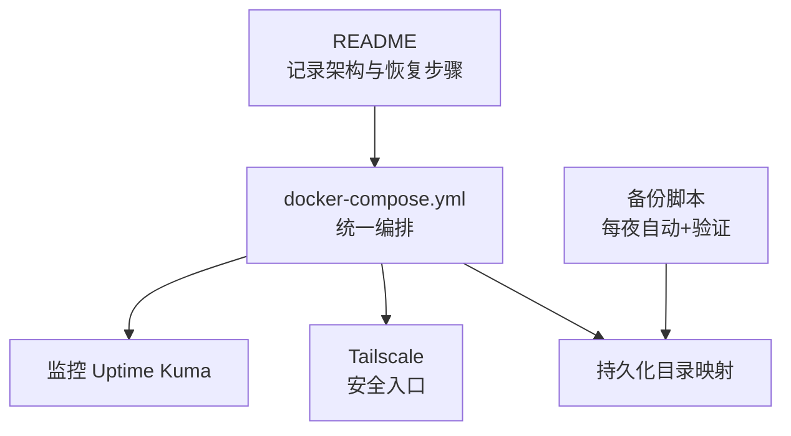

  

# 12 Homelab 实战样板：看看别人怎么组织

> ⏱ 大约 40 分钟 · 难度 ⭐⭐⭐ · 读别人的配置，学组织思路

> 🖼️ **关于本章配图**
> 这一章读的是别人的真实配置仓库，重点是目录结构与组织思路，而非某个软件界面。
>
> **替代方案**：我们用 Mermaid 图还原典型 homelab 的架构。真实界面请点进 [15.1 提到的 UP 主视频](../15-中文视频与博客/15.1-B站UP主.md) 观看演示。
>
> 如果你想为本章贡献一张高质量真实截图，欢迎提 PR，详见 [贡献指南](../../CONTRIBUTING.md)。

## 这一章讲什么

第 9 章的实战案例是"从零做一个场景"。这一章换个角度：**看真实开源项目是怎么组织一台家庭服务器的**，从它们的目录结构、配置方式里学思路。

GitHub 上有很多人公开了自己的 homelab 配置仓库——一个 `docker-compose.yml`、几个脚本、一份 README。这些仓库是最好的"作业范本"，因为它们是真在跑的东西，不是教程里的理想化示例。

> 💡 本章参考了 [kimzam30/my-homelab-setup](https://github.com/kimzam30/my-homelab-setup)、[jbaznik/homelab](https://github.com/jbaznik/homelab_codeasashu)、[northcutted/homelab](https://github.com/northcutted/homelab)、[truethari/home-lab](https://github.com/truethari/home-lab)、[SinghChinmayy/homelab](https://github.com/SinghChinmayy/homelab) 等真实项目，致谢见 [CREDITS](../../CREDITS.md)。

## 你会看到什么

| 小节 | 讲什么 |
| --- | --- |
| [12.1 一个 homelab 仓库长啥样](12.1-仓库结构.md) | 目录组织与配置思路 |
| [12.2 那些项目做对了什么](12.2-值得借鉴的实践.md) | 从真实项目里提炼的经验 |
| [12.3 搭你自己的样板](12.3-搭建自己的样板.md) | 从模仿到有自己的体系 |

## 一个典型的样子

几个真实项目反复出现的共同点：

1. **一个主 Compose 文件**管所有服务，而不是散落各处
2. **持久化目录**统一规划，一眼看出数据在哪
3. **Tailscale 收住入口**，不裸奔公网
4. **备份自动且有验证**——有的项目特别强调"verified nightly backups"
5. **README 写清楚架构和恢复步骤**

## 一句提醒

> ⚠️ 别人的配置是"作业参考"，不是"标准答案"。硬件、网络、需求不同，照搬未必合适。学的是组织思路，不是逐行复制。

## 写在最后

看懂几个真实项目，比读十篇理论更能建立"该怎么组织"的感觉。挑一两个读一读它的 README 和 Compose 文件。

## 动手试试

1. 打开上面链接里的任一项目，读它的 README，画出它的架构。
2. 记下它做得好的两点，想想能不能用到你自己的 NAS 上。
