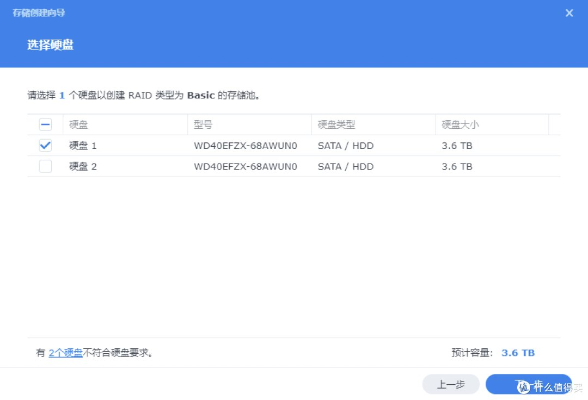

# 13.1 ZFS 调优：从"能用"到"好用"

> 📌 先读：[5.1 文件系统](../05-存储与数据保护/5.1-文件系统.md) · ⏱ 大约 18 分钟

## ZFS 的默认值其实已经很好

先说清楚：**大多数情况下，ZFS 的默认配置就够用**，不需要折腾调优。

这一节讲的是"当你想榨取更多性能、或遇到具体瓶颈时"该怎么调。没有具体问题的普通用户，看完了解即可，不必照改。

> 💡 本章内容参考了社区里多篇 ZFS 调优实践（见 [致谢](../../CREDITS.md)），尤其是"每 1TB 存储配 1GB ARC"这条广为流传的经验法则。

## 一、内存与 ARC（最关键）

ARC 是 ZFS 的读缓存，用内存换性能。它会自动增长，但你需要给它设个上限，别让它吃光所有内存。

一个流传很广的经验法则：

| 存储容量 | 建议 ARC | 系统最小内存 |
| --- | --- | --- |
| 1 TB | 1 GB | 4 GB |
| 4 TB | 4 GB | 8 GB |
| 10 TB | 8 GB | 16 GB |
| 50 TB | 16 GB | 32 GB |
| 100 TB | 32 GB | 64 GB |

即"每 1TB 存储约配 1GB ARC"。

限制 ARC 上限：

```bash
# 临时限制为 4GB
echo 4294967296 > /sys/module/zfs/parameters/zfs_arc_max

# 永久配置
cat > /etc/modprobe.d/zfs.conf <<'EOF'
options zfs zfs_arc_max=4294967296
options zfs zfs_arc_min=1073741824
EOF
```

> ⚠️ 不同系统（TrueNAS / 自装 ZFS）的配置位置和持久化方式不同，请以官方文档为准。

调优之前先看看存储池的实际状态。飞牛/群晖里创建存储池的界面是这样（概念相通）：

<p align="center">
  
</p>

> 💡 截图来自 [什么值得买的群晖教程](https://post.smzdm.com/p/agq0p693/)（见 [致谢](../../CREDITS.md)）。

## 二、recordsize（记录大小）

recordsize 决定 ZFS 读写数据块的大小，按用途调很有效：

| 用途 | 建议 recordsize | 原因 |
| --- | --- | --- |
| 数据库 | 16K | 小块随机读写多 |
| 虚拟机镜像 | 16K～64K | 减少写放大 |
| 大文件/影音 | 1M | 顺序大块读写更高效 |

```bash
sudo zfs set recordsize=16K tank/vmstore
sudo zfs set recordsize=1M tank/media
```

> 💡 这个设置要在**写入数据前**定好，对已有数据不会自动重组。

## 三、压缩与去重

- **压缩（compression）**：强烈建议开 `lz4`（或 `zstd`）。它不仅省空间，还常常**提升性能**——因为压缩后要读写的字节更少了。
- **去重（dedup）**：⚠️ **别轻易开**。去重极其吃内存，除非你完全理解它的影响，否则保持关闭。

```bash
sudo zfs set compression=lz4 tank/data
```

## 四、其他小贴士

- `atime=off`：关闭访问时间记录，减少写操作，大多数场景无感
- `primarycache=metadata`：大文件顺序读写的池（如影音），只缓存元数据更省内存
- SSD 做缓存/SLOG：高随机写场景（数据库、VM）才需要考虑

社区有一篇 [ZFS on Linux 六个月生产使用](https://besterry.com/posts/zfs-on-linux) 提到：他们从 ext4+mdadm 迁移到 ZFS 后，校验和发现了旧阵列上 14 个受影响的文件，而且 10TB 数据集的快照只需约 100ms——这正是 ZFS 校验与快照的价值。

## 调优的正确姿势


重申 [8.3 性能调优](../08-进阶主题/8.3-性能调优.md) 的心法：没有瓶颈就别调。调优是为了解决问题，不是为了跑分。

## 写在最后

ZFS 调优三件事：ARC 设上限、recordsize 按用途、开压缩关去重。默认值已经很好，只在有具体问题时才动手。

## 动手试试

1. 看看你的 ZFS 当前 ARC 大小和 recordsize 设置。
2. 检查是否已开启压缩（`zfs get compression tank`）。
