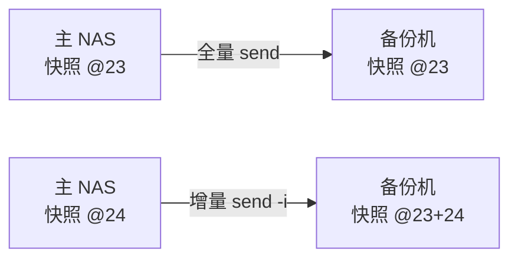

<p align="center">
  
</p>

# 13.2 zfs send/recv：高效的异地复制

> 📌 先读：[5.4 备份 3-2-1](../05-存储与数据保护/5.4-备份3-2-1原则.md) · ⏱ 大约 15 分钟

## 这是什么

`zfs send/recv` 是 ZFS 自带的复制机制，能把一个数据集（连同它的快照）**按块级增量**复制到另一台机器。

为什么它适合异地备份？

- **增量**：第一次全量，之后只传变化的部分，省带宽
- **保留快照历史**：目标端也有一模一样的快照链，能回到任意时间点
- **块级**：比文件级同步更高效、更一致

> 💡 有资料把它称为"best backup"级别的工具——因为它复制的是整个数据集状态，而不只是文件。见 [致谢](../../CREDITS.md) 中的 ZFS 实战文章。

## 基本用法

### 全量发送（第一次）

```bash
# 在主 NAS 上创建快照
sudo zfs snapshot tank/photos@20261123

# 发送复制到备份机（通过 ssh）
sudo zfs send tank/photos@20261123 | ssh root@backup-host "zfs receive backup/photos"
```

### 增量发送（之后每次）

关键在于 `-i` 参数指定"从哪个快照开始"：

```bash
# 主 NAS 上新快照
sudo zfs snapshot tank/photos@20261124

# 只发两个快照之间的差异
sudo zfs send -i tank/photos@20261123 tank/photos@20261124 \
  | ssh root@backup-host "zfs receive backup/photos"
```



## 需要注意的坑

> ⚠️ **目标端不能有同名数据集的写入**，否则 receive 会失败。备份端的数据集应保持"只读接收"状态。
>
> ⚠️ **增量链不能断**：目标端必须保留发送端引用的那个基础快照，否则增量发送无法应用。别在备份端乱删快照。
>
> ⚠️ **send 前先 snapshot**：快照是 send 的单位，没有快照就发不了。

## 自动化

把 send/recv 写成脚本，配合定时任务（cron）自动执行。社区有多篇现成的脚本思路（见 [致谢](../../CREDITS.md)），核心逻辑就是：

1. 在源端创建带时间戳的快照
2. send 到目标端
3. 清理过期的旧快照（保留最近 N 个）

## 和 3-2-1 的关系

zfs send/recv 解决的是"异地那份拷贝"——它是 [5.4 备份 3-2-1](../05-存储与数据保护/5.4-备份3-2-1原则.md) 里"1 份异地"的绝佳实现方式之一。

> 💡 但它仍不是万能的：如果源端被勒索病毒加密，加密后的数据也会被 send 到备份端。所以除了异地复制，**离线/不可变的备份**仍有必要，见 [5.4](../05-存储与数据保护/5.4-备份3-2-1原则.md)。

## 写在最后

zfs send/recv 是 ZFS 用户做异地备份的利器：全量打底、增量跟进、快照链完整。记住"目标端别乱写、基础快照别乱删"两条即可。

## 动手试试

1. 在两台 ZFS 机器间做一次全量 send/recv 练习。
2. 再做一次增量 send，感受只传差异的速度。
