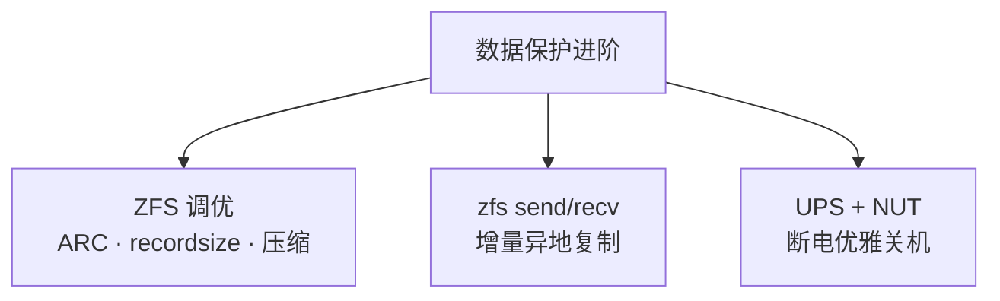

  

# 13 数据保护进阶：从"够用"到"扎实"

> ⏱ 大约 50 分钟 · 难度 ⭐⭐⭐⭐ · 进阶内容，量力而行

## 这一章讲什么

第 5 章讲的是数据保护的"必修课"——RAID、快照、3-2-1 备份、硬盘监控。

这一章往上再走一层，讲三块进阶主题：

1. **ZFS 调优**：ARC 内存、recordsize、压缩，把 ZFS 从"能用"调到"好用"
2. **zfs send/recv**：块级增量复制，做真正高效的异地备份
3. **UPS + NUT**：断电时让 NAS 优雅关机，而不是硬断电损坏数据

这些内容来自社区里大量实战经验的提炼，我们在正文和 [致谢](../../CREDITS.md) 里都标注了来源。

## 你会看到什么

| 小节 | 讲什么 |
| --- | --- |
| [13.1 ZFS 调优](13.1-ZFS调优.md) | 内存、记录大小、压缩的调优原则 |
| [13.2 zfs send/recv 异地复制](13.2-zfs-send-recv.md) | 块级增量备份怎么做 |
| [13.3 UPS 与 NUT 断电保护](13.3-UPS与NUT.md) | 让 NAS 优雅应对停电 |

## 一句提醒

> ⚠️ 进阶不等于"必须做"。如果你的数据保护已经满足需求，把时间花在别处更有价值。这一章是给你"想再进一步"时准备的。

## 写在最后

从"够用"到"扎实"，靠的是理解原理 + 定期验证。调优不追求极致跑分，追求的是稳定和可预测。

## 动手试试

1. 这三块里，哪一块最符合你现在的需求？写下来。
2. 如果你用 ZFS，先看看当前的 ARC 使用情况和 recordsize 设置。
