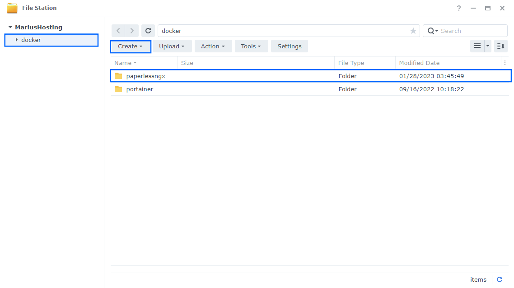
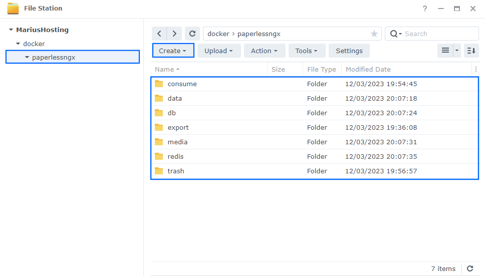
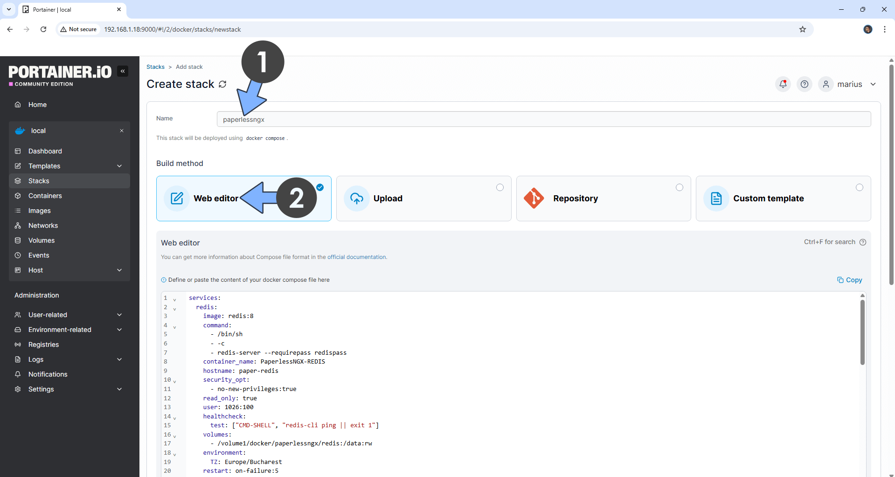

# 14.3 Paperless-ngx：纸质文件的克星

## 它解决什么问题

发票、合同、说明书、孩子的作业……纸质文件越堆越多，找的时候翻箱倒柜。

Paperless-ngx 把纸质文件**扫描进来、自动 OCR 识别文字、按标签归档、全文检索**。以后想找某张发票，搜个关键字就行。这是很多人装上后"后悔没早点装"的工具。

## 部署

它包含多个组件（Web、数据库、Redis、文档转换等），官方 Compose 比较长。示例在 [`examples/docker-compose/paperless-ngx/docker-compose.yml`](../../examples/docker-compose/paperless-ngx/docker-compose.yml)（基于官方 Compose 改写）。

关键要改的三个变量（社区指南反复强调）：

```yaml
environment:
  - PAPERLESS_ADMIN_USER=admin        # 改成你的用户名
  - PAPERLESS_ADMIN_PASSWORD=CHANGE_ME # 改成强密码
  - PAPERLESS_TIME_ZONE=Asia/Shanghai  # 你的时区
```

关键的卷映射：

```yaml
volumes:
  - /volume1/docker/paperless-ngx/data:/usr/src/paperless/data     # 数据库
  - /volume1/docker/paperless-ngx/media:/usr/src/paperless/media   # 文档
  - /volume1/docker/paperless-ngx/consume:/usr/src/paperless/consume  # 扫描投递目录
```

> 💡 分卷存储是个好习惯——data、media、consume 分开，备份和迁移都方便。见 [SelfHostHero 的部署指南](https://selfhosthero.com/?p=3345/)（[致谢](../../CREDITS.md)）。

部署完成后，在浏览器里看到的是这样的管理界面：

<p align="center">
  
</p>

<p align="center">
  
</p>

<p align="center">
  
</p>

> 💡 截图来自 [Marius Hosting 的 NAS 部署教程](https://mariushosting.com/how-to-install-paperless-ngx-on-your-synology-nas/)（见 [致谢](../../CREDITS.md)）。

## 怎么用

1. 浏览器访问 `http://<NAS的IP>:8010`，用设置的管理员账号登录
2. 把纸质文件扫描成 PDF，放进 `consume` 目录（或直接在网页上传）
3. Paperless 自动 OCR、提取日期/标题、应用标签
4. 在网页里按标签、日期、全文搜索找文件

> 💡 手机扫描 App（如各类扫描全能王替代品）可以直接把 PDF 丢进 `consume` 的 SMB 共享，实现"扫完自动归档"。

## 实测验证

1. 上传一个测试 PDF，确认 OCR 后能搜到里面的文字
2. 检查 `consume` 目录里的文件是否被处理后移走
3. 重启容器，确认文档和标签都还在（持久化正确）

## 备份提醒

Paperless 里可能存着合同、证件等敏感文档。记得：

- `data` 和 `media` 两个目录都要备份
- 加密后异地存储（见 [5.4](../05-存储与数据保护/5.4-备份3-2-1原则.md)）
- 别把它暴露公网，要远程访问用 VPN

## 写在最后

Paperless-ngx 把杂乱的纸质文件变成可搜索的数字档案。改好三个变量、分卷存储、定期备份，就能安心用。

## 动手试试

1. 部署 Paperless-ngx，完成管理员设置。
2. 扫描或找一份 PDF 丢进 consume 目录，验证 OCR 和搜索效果。
