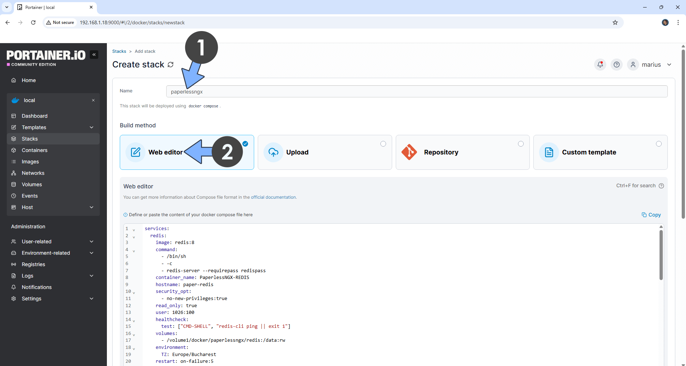
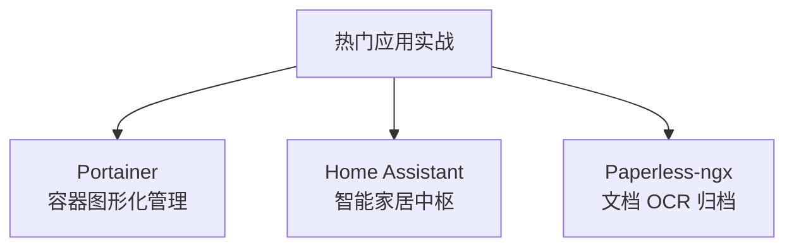

  

# 14 热门应用实战：三个值得单独讲的工具

> ⏱ 大约 60 分钟 · 难度 ⭐⭐⭐ · 要动手

  

> 💡 真实界面截图来自 [mariushosting.com](https://mariushosting.com/)，见 [致谢](../../CREDITS.md)。

## 这一章讲什么

第 10 章给了你一张应用地图，里面提到很多工具。其中有三个特别高频，值得单独展开：

- **Portainer**——容器管理界面，不想敲命令的人的救星
- **Home Assistant**——智能家居中枢，能把你家的设备串起来
- **Paperless-ngx**——文档管理神器，纸质文件的克星

每一节都按"它解决什么问题 → 怎么装 → 怎么配置 → 实测验证"来写，配可运行的 Compose 示例。

> 💡 本章参考了多个社区的部署实践（见 [致谢](../../CREDITS.md)），用官方 Compose 为基础改写，路径改成 NAS 通用写法。

## 你会看到什么

| 小节 | 讲什么 |
| --- | --- |
| [14.1 Portainer](14.1-Portainer.md) | 用界面管理 Docker 容器 |
| [14.2 Home Assistant](14.2-Home-Assistant.md) | 智能家居中枢 |
| [14.3 Paperless-ngx](14.3-Paperless-ngx.md) | 纸质文件数字化 |

## 一句提醒

> ⚠️ 这三个都是"装了容易、用好要花时间"的工具。先明确你有没有这个需求，再动手。特别是 Home Assistant，水很深。

## 写在最后

工具是手段不是目的。这一章把最常见的三个讲透，你照着做能少走弯路。

## 动手试试

1. 三个里哪个最符合你的需求？写下来。
2. 确认你读过 [7.1 Docker 基础](../07-应用服务/7.1-Docker基础.md)。
