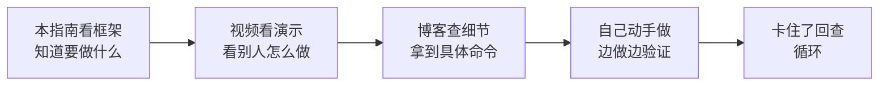

  

# 15.3 视频 + 文字 + 实操：怎么配合学

## 三类资源，各有分工

| 资源 | 擅长 | 不擅长 |
| --- | --- | --- |
| 视频（B 站） | 看真实操作、理解画面感强的步骤 | 查某个具体命令、跳读 |
| 图文博客（CSDN 等） | 查步骤、复制命令、按目录跳读 | 复杂操作的直观演示 |
| 本指南 | 建立整体框架、路线图、Checklist | 替代视频的逐帧演示 |

聪明的用法是**三者配合**，而不是只依赖一种。

## 一个高效学习闭环

### 第一步：用本指南建立框架

先读对应章节的"概览"和"步骤"，知道这件事大概分几步、关键点在哪。这样看视频时不会迷失在细节里。

### 第二步：用视频看演示

找一条对口的视频，重点看**画面感强的部分**：BIOS 怎么设、接线怎么接、界面点哪里。遇到关键步骤，暂停、记下来。

### 第三步：用博客查细节

需要具体命令、参数、配置项时，翻图文博客——可搜索、可复制，比拖视频进度条快得多。

### 第四步：自己做一遍

这是最关键的一步。**看十遍不如做一遍**。照着做，遇到报错就回查、搜索、看评论。

## 避坑清单

> ⚠️ **坑 1：收藏=学会的错觉。** 收藏夹里躺着几十条教程，一条没做过——这不叫学习。挑一条，现在就做。
>
> ⚠️ **坑 2：教程版本过时。** NAS 系统迭代快，2023 年的教程里的界面可能和 2026 年完全不同。优先看近一年的，注意视频/文章的发布时间。
>
> ⚠️ **坑 3：照搬命令不看懂。** 博客里的 `dd`、`rm`、`zfs destroy` 这类命令，执行前要理解它在做什么。见 [附录 A](../附录/A-命令速查.md) 的警告。
>
> ⚠️ **坑 4：只看不验证。** 装完一个服务，要按 [4.5 验收清单](../04-第一次搭建/4.5-验收清单.md) 那样逐项确认——不是"看起来能打开"就算成功。

## 记笔记的建议

边学边记，写清三件事：

1. **我做了什么**（步骤）
2. **哪里和教程不一样**（你的设备/版本差异）
3. **踩了什么坑、怎么解决的**（最有价值的部分）

这份笔记将来就是你自己的"排障手册"。贡献到本仓库的话，还能帮到别人，见 [贡献指南](../../CONTRIBUTING.md)。

## 写在最后

信息过载的时代，稀缺的不是教程，而是"把一条教程走到底"的执行力。选一个目标，三类资源配合着用，动手做一遍——这就是最快的学习法。

## 动手试试

1. 挑一个你一直"收藏了没做"的教程，今天做第一步。
2. 建一个笔记，按上面三条记下过程。
