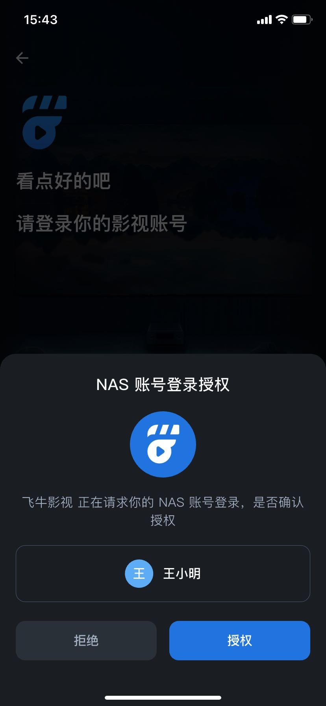
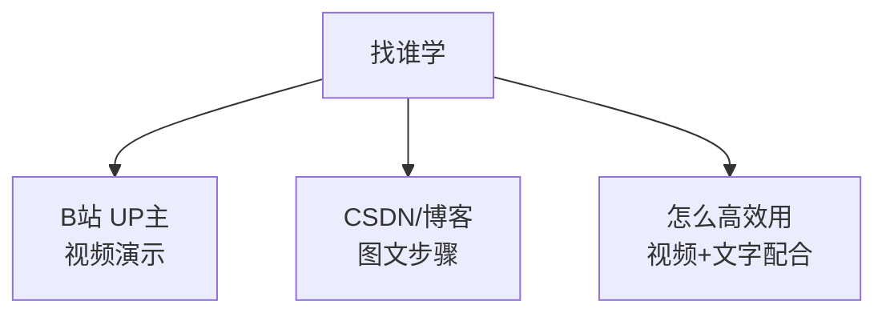

  

# 15 中文视频与博客：跟着谁学

> ⏱ 大约 40 分钟 · 当成"资源索引"来逛

> 🖼️ **关于本章配图**
> 本章概览配了一张来自飞牛官方帮助中心的真实界面图，帮你建立直观印象。
>
> **替代方案**：我们用应用图谱插画作为章节标识。想看真实操作界面，跟着本章链接去看原视频——那正是视频媒介的价值所在。
>
> 如果你想为本章贡献一张高质量真实截图，欢迎提 PR，详见 [贡献指南](../../CONTRIBUTING.md)。

  

> 💡 真实界面截图来自 [飞牛官方帮助中心](https://help.fnnas.com/)（见 [致谢](../../CREDITS.md)）。

## 为什么有这一章

文字教程有个短板：**有些操作，看别人点一遍比读十段文字管用。** 尤其是 BIOS 设置、虚拟机直通、系统安装这种"画面感"很强的内容。

中文圈里其实有大量讲得极好的 UP 主和博主。这一章把他们整理成一张"该找谁"的地图——你想解决什么问题，就去找对应的人。我们会把他们的核心观点用自己的话提炼出来，并给出**原文/视频链接，署名归原作者**。

> 💡 本章内容整理自 B 站多位 UP 主的视频和 CSDN 等博客，来源见 [致谢](../../CREDITS.md)。我们只做提炼和索引，**具体步骤请去看原视频/原文**——那里有最详细的画面演示。

## 你会看到什么

| 小节 | 讲什么 |
| --- | --- |
| [15.1 B 站 UP 主地图](15.1-B站UP主.md) | 按需求找博主 |
| [15.2 CSDN 与博客精选](15.2-CSDN与博客.md) | 优质图文博客索引 |
| [15.3 视频与文字配合学习法](15.3-配合学习法.md) | 怎么把两类资源用出效果 |

## 一句提醒

> ⚠️ 看视频容易陷入"收藏了=学会了"的错觉。真正掌握，还是要**自己动手做一遍**。把视频当演示，把这份指南当 Checklist，边看边做。

## 写在最后

站在别人的肩膀上，比自己从零摸索快得多。找到对的人，能省下大量试错时间。

## 动手试试

1. 从下面挑一个和你当前需求最匹配的 UP 主，去看他的一条视频。
2. 边看边记下他和你指南里不一样的做法——那往往就是经验。
