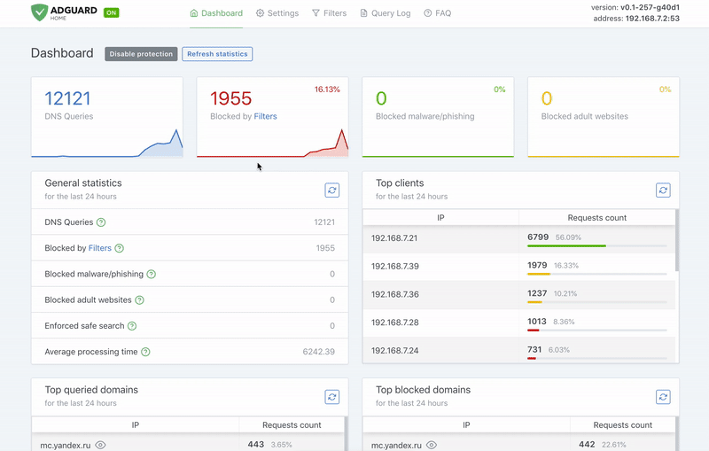

# 16.1 AdGuard Home：全家的广告，在 DNS 层就没了

## 它解决什么问题

手机 App 里的广告、网页弹窗、电视开机广告……每台设备装一个广告屏蔽 App 太麻烦。

AdGuard Home 换个思路：**在网络入口（DNS）就把广告域名拦掉**。全家设备不用装任何东西，只要把 DNS 指向它，广告就没了。这是那种"装完全家都说好"的服务。

<p align="center">
  
</p>

> 💡 截图来自 [AdGuard 官方仓库](https://github.com/AdguardTeam/AdGuardHome)（见 [致谢](../../CREDITS.md)）。

## 部署

示例在 [`examples/docker-compose/adguardhome/docker-compose.yml`](../../examples/docker-compose/adguardhome/docker-compose.yml)：

```yaml
version: "3.8"
services:
  adguardhome:
    image: adguard/adguardhome:latest
    container_name: adguardhome
    restart: unless-stopped
    volumes:
      - ${NAS_DATA:-/volume1/docker}/adguard/work:/opt/adguardhome/work
      - ${NAS_DATA:-/volume1/docker}/adguard/conf:/opt/adguardhome/conf
    ports:
      - "53:53/tcp"
      - "53:53/udp"
      - "3000:3000/tcp"   # 初始设置
      - "80:80/tcp"       # 管理界面
```

> ⚠️ 53 端口是 DNS 服务端口，可能和 NAS 自带的 DNS 服务冲突。冲突时先关掉系统自带的 DNS 功能。

## 首次配置

1. 浏览器访问 `http://<NAS的IP>:3000`，进入初始设置向导
2. 设置管理员账号密码
3. 配置监听接口（默认即可）
4. 完成后用 80 端口访问管理界面

AdGuard Home 的上游 DNS 可以选国内镜像（如 `223.5.5.5`、`119.29.29.29`）或加密 DNS（DoH/DoT），国内环境建议先用普通上游，够稳。

## 让全家设备走它

关键一步：**把路由器或设备的 DNS 改成 NAS 的 IP**。

- 路由器 DHCP 里把 DNS 服务器指向 NAS → 全家设备自动生效 ✅ 最省事
- 或者单台设备手动改 DNS（手机 WiFi、电脑网络设置）

> 💡 注意别把 AdGuard Home 的 DNS 再指向自己，会形成环路。上游要填外部 DNS。

## 实测验证

1. 打开之前有广告的网站/App，看广告是否被拦
2. 管理界面看"查询日志"，能看到被拦截的请求
3. 看仪表盘的拦截率——通常装完几分钟就能到 10%～30%

## 写在最后

AdGuard Home 是"装完立刻有感"的代表。注意 DNS 是网络核心，改之前想清楚，出问题能改回来（把路由器 DNS 改回原来的即可）。

## 动手试试

1. 部署 AdGuard Home，完成初始设置。
2. 把一台设备的 DNS 指向它，对比前后广告情况。
