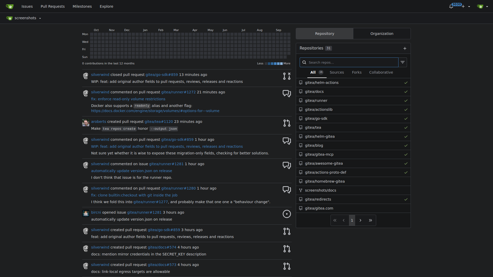
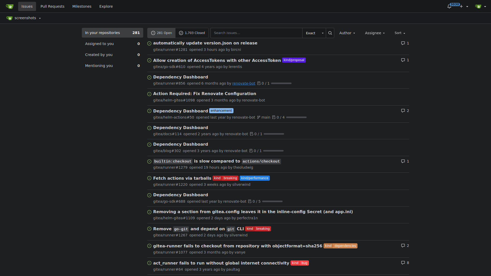

# 16.3 Gitea：自建一个轻量代码托管

## 它解决什么问题

代码放在第三方平台当然方便，但有些东西你想自己掌控——私有项目、实验性代码、或者就是想要"数据在自己手里"的踏实。

Gitea 是一个轻量的自建 Git 服务：仓库、Issue、Pull Request、Wiki 都有，资源占用却很小，很适合跑在 NAS 上。不只是程序员，它也能当轻量协作平台用。

<p align="center">
  
</p>

<p align="center">
  
</p>

> 💡 截图来自 [Gitea 官方仓库](https://github.com/go-gitea/gitea)（见 [致谢](../../CREDITS.md)）。

## 部署

示例在 [`examples/docker-compose/gitea/docker-compose.yml`](../../examples/docker-compose/gitea/docker-compose.yml)：

```yaml
version: "3.8"
services:
  gitea:
    image: gitea/gitea:latest
    container_name: gitea
    restart: unless-stopped
    environment:
      - USER_UID=1000
      - USER_GID=1000
    volumes:
      - ${NAS_DATA:-/volume1/docker}/gitea:/data
      - /etc/timezone:/etc/timezone:ro
    ports:
      - "3000:3000"   # Web
      - "2222:22"     # SSH
```

关键点：
- `/data` 存所有仓库和配置，**必须持久化**
- SSH 端口映射成 `2222`（避开 NAS 自身的 22）
- 首次访问会进入安装向导

## 首次配置

1. 访问 `http://<NAS的IP>:3000`
2. 安装向导里填写数据库（选 SQLite 最省事，单机够用）
3. 设置站点名称、管理员账号
4. 装完后就能建仓库了

## 实测验证

1. 建一个测试仓库，`git clone` 下来（SSH 地址用 `ssh://git@<IP>:2222/...`）
2. 提交一次改动并 push
3. 在网页里提一个 Issue，确认通知正常

## 备份提醒

Gitea 的所有数据在 `/data`，其中仓库在 `/data/git/repositories`。记得把整个 `/data` 纳入备份，见 [5.4](../05-存储与数据保护/5.4-备份3-2-1原则.md)。

## 写在最后

Gitea 让"代码在自己手里"变得很简单。对多数人它是 git 服务的轻量备选；对小团队，它也是不错的协作平台。

## 动手试试

1. 部署 Gitea，建一个测试仓库。
2. 用本机 git 克隆并推送一次，验证 SSH 连接。
