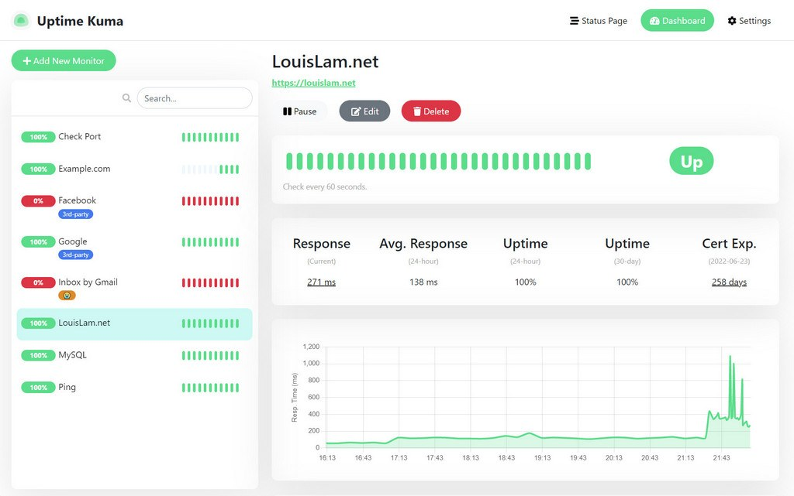

# 16.4 Uptime Kuma：服务挂了，让它先告诉你

## 它解决什么问题

NAS 上跑了一堆服务，怎么知道哪个挂了？总不能一天刷八次吧。

Uptime Kuma 就是干这个的：它能定时探测你的服务（HTTP、TCP、Ping、Docker 容器…），挂了就通过邮件、Telegram、微信等渠道告警。界面还特别好看，很多人装它是"为了那个仪表盘"。

<p align="center">
  
</p>

> 💡 截图来自 [Uptime Kuma 官方仓库](https://github.com/louislam/uptime-kuma)（见 [致谢](../../CREDITS.md)）。

## 部署

示例在 [`examples/docker-compose/uptime-kuma/docker-compose.yml`](../../examples/docker-compose/uptime-kuma/docker-compose.yml)（仓库里已有）：

```yaml
version: "3.8"
services:
  uptime-kuma:
    image: louislam/uptime-kuma:1
    container_name: uptime-kuma
    restart: unless-stopped
    volumes:
      - ${NAS_DATA:-/volume1/docker}/uptime-kuma:/app/data
    ports:
      - "3001:3001"
```

`/app/data` 持久化监控配置和历史数据，必须映射。

## 首次配置

1. 访问 `http://<NAS的IP>:3001`，设置管理员账号
2. 点"新增监控项"，类型选 HTTP，填你要盯的服务地址
3. 设置检查间隔（默认 60 秒）

## 配告警

Uptime Kuma 支持多种通知渠道：

| 渠道 | 适合 |
| --- | --- |
| 邮件 | 通用，需 SMTP 配置 |
| Telegram | 手机即时收到 |
| 企业微信/钉钉 | 国内团队 |
| Webhook | 接其他自动化系统 |

> 💡 建议至少配一种——不然监控了也没人知道。告警渠道配置见管理界面的"通知设置"。

## 实测验证

1. 添加一个监控项指向一个正常服务，确认状态是"正常"（绿色）
2. 故意停掉那个服务，等一个检查周期，看是否变红并触发告警
3. 恢复服务，确认自动变绿

> ⚠️ 别只对监控页面本身做监控——那没意义。要盯的是你真正在意的服务。

## 写在最后

Uptime Kuma 是"小而美"的典范。装上它，服务出问题你能第一时间知道，而不是等家人抱怨"怎么打不开了"。

## 动手试试

1. 部署 Uptime Kuma，添加 3 个你最在意的服务。
2. 配一个通知渠道，做一次"故意停服务"的告警测试。
