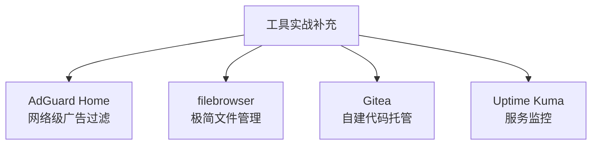

  

# 16 工具实战补充：图谱里那些"值得单独说"的

> ⏱ 大约 50 分钟 · 难度 ⭐⭐⭐ · 要动手

## 这一章讲什么

第 10 章给了你一张应用地图，里面提到 AdGuard Home、Gitea、filebrowser、Uptime Kuma 这些工具，但只是一笔带过。

这一章把其中四个最高频的展开成"安装 + 配置 + 实测"小节。它们有个共同点：**装完立刻能感受到变化**——全家广告没了、文件管理清爽了、代码有地方放了、服务挂了能第一时间知道。

> 💡 本章延续第 14 章的写法，用官方 Compose 为基础改写，路径换成 NAS 通用写法，每张图都标注来源。

## 你会看到什么

| 小节 | 讲什么 |
| --- | --- |
| [16.1 AdGuard Home](16.1-AdGuard-Home.md) | 全家设备的 DNS 广告过滤 |
| [16.2 filebrowser](16.2-filebrowser.md) | 一个网页就能管文件 |
| [16.3 Gitea](16.3-Gitea.md) | 轻量自建 Git 服务 |
| [16.4 Uptime Kuma](16.4-Uptime-Kuma.md) | 服务监控与告警 |

## 一句提醒

> ⚠️ 这四个工具都涉及网络与数据访问，注意权限和公网暴露问题。远程访问优先用 VPN，见 [6.2](../06-网络与远程访问/6.2-远程访问方案对比.md)。

## 写在最后

工具的价值不在"多"，而在"刚好解决你的问题"。这四个是很多人的"装机四件套"，按需取用。

## 动手试试

1. 这四个里你最想先装哪个？写下理由。
2. 装完一个后，按 [4.5 验收清单](../04-第一次搭建/4.5-验收清单.md) 的习惯验证一下。
