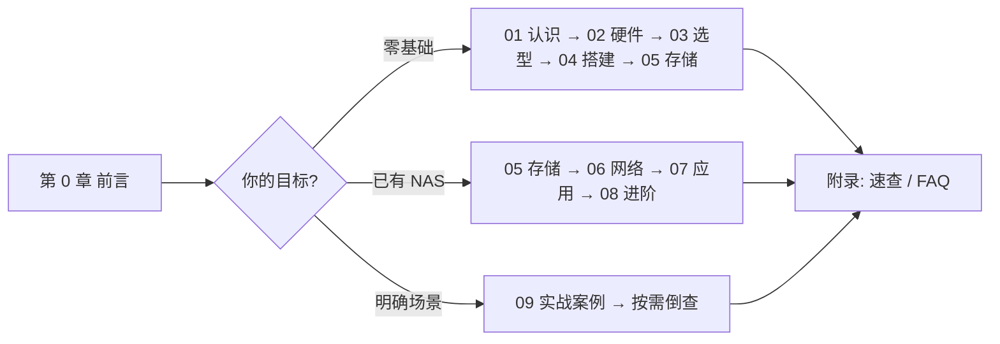

  

# 欢迎来到 NAS 入门指南

> 从零开始的 NAS 搭建与自托管实践 · 面向中文读者 · 多平台横向对比

这是一套系统、可动手的 NAS 教程。它把散落在论坛、博客、视频里的碎片化经验，整理成一条清晰的学习路径。

## 从这里开始

请选择最适合你的入口：

| 你的情况 | 建议入口 |
| --- | --- |
| 完全零基础，还没买设备 | [第 1 章 认识 NAS](01-认识NAS/README.md) → [第 2 章 硬件选型](02-硬件选型/README.md) |
| 已买好设备，不知道装什么系统 | [第 3 章 平台横评与选型](03-平台横评与选型/README.md) |
| 系统装好了，想安全用好数据 | [第 5 章 存储与数据保护](05-存储与数据保护/README.md) |
| 想在外网访问家里的 NAS | [第 6 章 网络与远程访问](06-网络与远程访问/README.md) |
| 想跑 Docker、影音、AI 应用 | [第 7 章 应用服务](07-应用服务/README.md) |
| 带着明确目标，想照着做 | [第 9 章 实战案例](09-实战案例/README.md) |

## 三条阅读路径

## 内容覆盖

- **6 大平台**：群晖 DSM、威联通 QTS/QuTS、TrueNAS、CasaOS、飞牛 fnOS、树莓派
- **10 个章节**：从概念到实战，零基础到进阶
- **配套资源**：可运行示例、每章练习、架构图、写作模板

## 一点说明

本项目只提供教程、经验与配置示例，**不提供任何软件下载**。所有工具请前往官方渠道获取。技术操作有风险，动手前请做好备份。详见 [README 免责声明](https://github.com/cv-superding/nas-guide#免责声明)。

---

开始阅读：[完整目录 SUMMARY.md](SUMMARY.md) · [如何使用本指南](00-前言/如何使用本指南.md)
