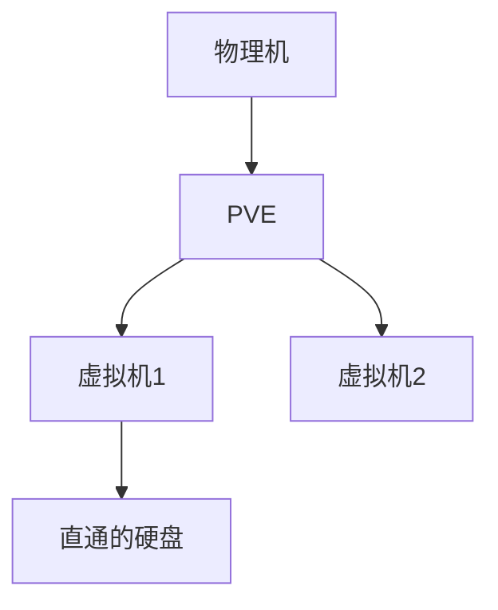

# 练习 · 11 PVE 底层方案

> ⚠️ 这一章是进阶内容。如果你还没装过 NAS，建议先完成 04～07 章的练习再回来。

## 练习一：判断该不该上虚拟化

在动手前，先诚实回答：

| 问题 | 我的答案 |
| --- | --- |
| 我现在的 NAS 负载如何？有没有闲置性能？ | |
| 我需要同时跑几个不同的系统吗？ | |
| 我愿意花时间排查直通、IOMMU 这类问题吗？ | |
| 我的重要数据有独立备份吗？（没有就别上） | |
| 家人能接受偶尔的服务中断吗？ | |

结论（值得上 / 别碰 / 再等等）：____________________

## 练习二：硬件兼容性自查

虚拟化和直通对硬件有要求，动手前先查：

- [ ] CPU 支持虚拟化（Intel VT-x / AMD-V）
- [ ] 主板/CPU 支持 IOMMU（Intel VT-d / AMD-Vi）——直通需要
- [ ] 内存够分给几台虚拟机（建议 16GB+）
- [ ] 有独立的 SSD 做系统盘

查询记录：
> CPU 型号：________ IOMMU 支持：________ 内存：________

## 练习三：画一张你的虚拟架构图

用 Mermaid 或纸笔画出：物理机 → PVE → 各虚拟机/容器 → 硬盘直通关系。

你的架构（贴在下面）：
>

## 练习四：回退预案

上 AIO 前必须想好怎么退回来：

- [ ] 保留了裸机安装的镜像/U 盘
- [ ] 记录了直通设置、网络规划
- [ ] 重要数据有一份不在宿主机上

写下一句话的回退步骤：
> ________________________________
