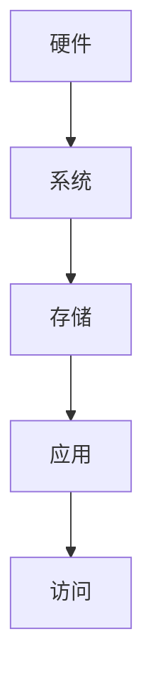

# 9.N 案例名称

> 场景：一句话描述（用户是谁、想解决什么问题）

## 场景描述

用一小段话描述人物、现状与诉求，让读者产生代入感。

## 需求分析

| 需求 | 对应章节 |
| --- | --- |
| 需求 1 | [章节链接] |
| 需求 2 | [章节链接] |

## 方案设计

**硬件建议**：参考 [2.4](TODO:请填入相对路径) 的哪一档配置。

**系统建议**：可选系统及理由。

## 实施步骤

1. 步骤一（链接到相关章节）
2. 步骤二
3. ...

## 验收清单

- [ ] 检查项 1
- [ ] 检查项 2
- [ ] 恢复演练（如适用）

## 常见问题

**Q：问题？**
A：回答。

## 风险提示

> ⚠️ 本案例的注意事项。

## 小结

一句话总结这个案例的核心。

## 练习

1. ________________
2. ________________
